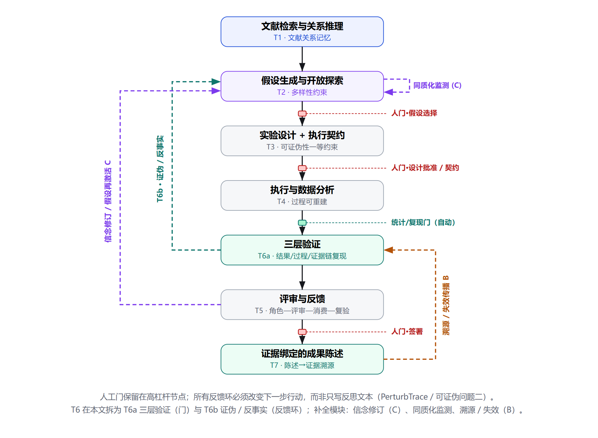
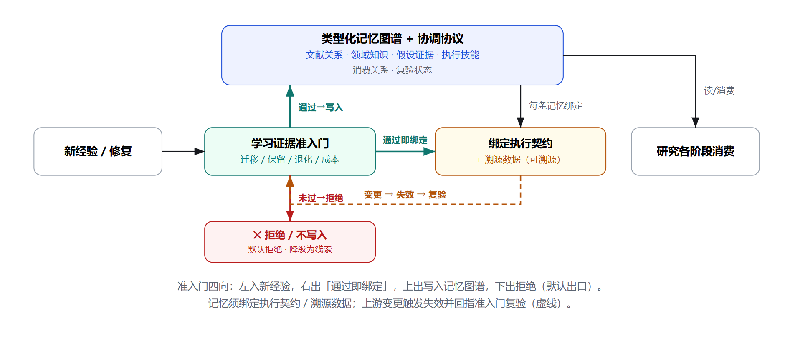
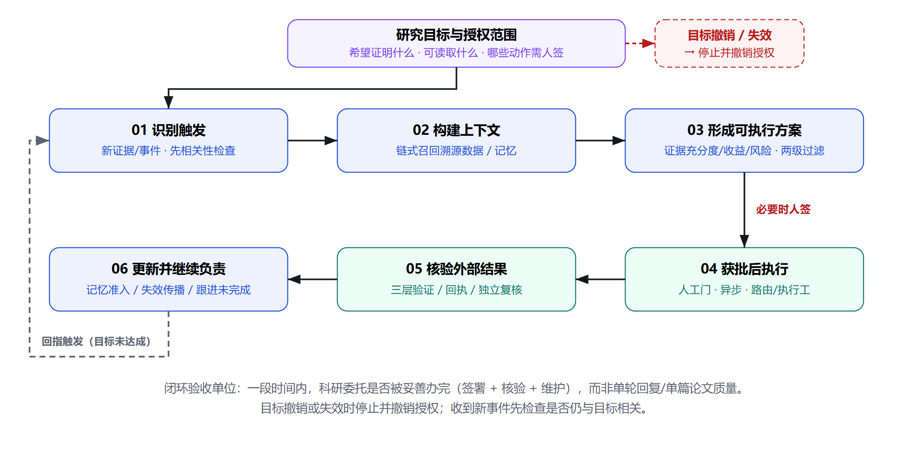
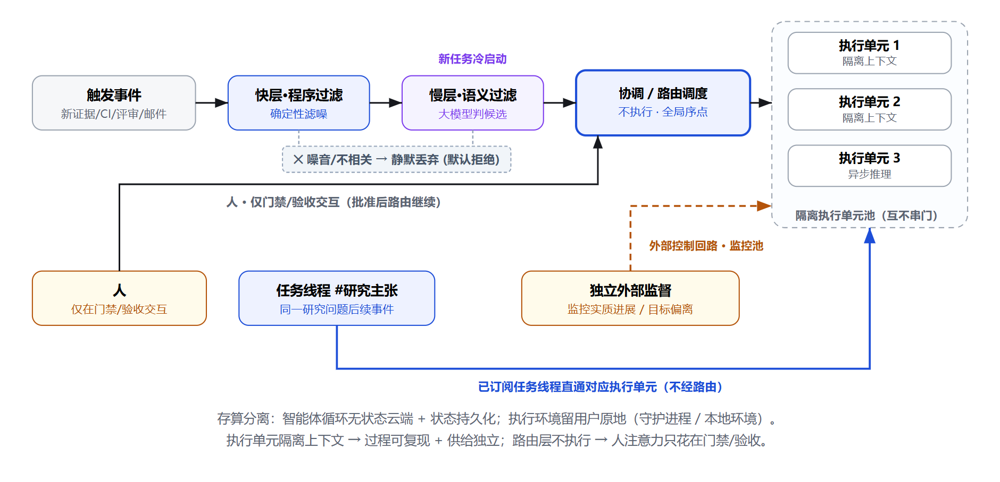

# Wellspring-Agent：自改进科研智能体

> **Wellspring-Agent** 是一个自改进科研智能体：打开前端即进入工作台（任务线程 + 运行上下文），配本地 runtime / CLI / MCP；证据可审计、能力可插拔、执行外包 Harness²。
> 不是"全自动投稿机器"——人工门由人签，或写一次 `autopilot-policy.json` 后由 autopilot 在边界内代签（签名标 `delegated`、带策略哈希），投稿仍然不做。
> 研究状态、度量口径与逐项实测读数见 [`docs/fact-baseline.md`](docs/fact-baseline.md)。

## 项目定位：Wellspring-Agent ≠ research-agent

| | **本仓库 `Wellspring-Agent`（智能体产品）** | `research-agent`（早期 demo 项目） |
| --- | --- | --- |
| 打开前端 | **即进入工作台**：任务线程 + 运行上下文 + Composer，直接干活 | 打开是展示主页（策略论证、七幕演示、检索实验室） |
| 形态 | `apps/web` 工作台 + `research_agent` runtime/CLI + MCP | 静态展示镜像（GitHub Pages） |
| 真实执行 | 本地 runtime / CLI / Harness² 接缝 | 无（SIM / CACHED） |
| 关系 | **开发一律以本仓库定位为准** | 历史遗留；本仓库 `site/` 仅保留运行产物与研究文档页，页面结构不沿用 demo 项目 |

## 先看这六个入口

| 入口 | 回答 |
| --- | --- |
| [`apps/web/`](apps/web/) | **智能体工作台（产品本体）**：打开即任务线程 + 上下文面板；`npm run dev` 接本地 runtime，`site/app/` 为构建产物 |
| [`QUICKSTART.md`](QUICKSTART.md) | 10 分钟怎么跑起来；MCP、revision、AstraDraw、HTTP 最小命令 |
| [`ARCHITECTURE.md`](ARCHITECTURE.md) | 哪些是稳定内核、哪些可扩展、当前实现到什么程度 |
| [`integrations/README.md`](integrations/README.md) | Qoder / Claude Code / Zcode、人工门与项目目录 |
| [`integrations/FRAMEWORKS.md`](integrations/FRAMEWORKS.md) | LangGraph / CrewAI / AutoGen / HTTP / Python SDK |
| [`modules/README.md`](modules/README.md) | 模块 SPEC、扩展点与新模块流程 |

## 研究策略与流程图（1110 组会论证口径）

一句话主张：**不做端到端「自动写论文」**——做两件事：**让过程可信**，**让判定真正改变下一步行动**。验收单位从「一篇论文」改成「一段时间里，科研委托有没有办完：签署、核验、维护」。新颖性只落在四处：**证据链复现 · 失效传播 · 判定消费 · 学习证据准入**；度量与门间自动化借鉴外部成熟契约（ARS / CCFA），不重造。

下面四张图是**同一系统的四个投影**，不是实现地图；建议按 ③ → ① → ② → ④ 读。图例：红色 = 人工门（G1 想法选择 · G2 设计批准 · S5b 结果人签 · G5 闭包签署），青色 = 自动门（默认拒绝），虚线 = 反馈环（回指更早阶段且改变下一步动作）。图片为《科研智能体策略论证》（1110 可读性修订版）原版 SVG 的 PNG 导出（`figures/`），与公开站 `site/index.html` 的「DESIGN / 系统投影」区同一来源。

### 图 ① 过程可信主循环（策略① / 方向 B · 守内核）

七个阶段、四条反馈环、四道门。反馈（证伪 / 反事实、信念修订、溯源 / 失效传播）都**回指更早阶段并改变下一步动作**，不是只写反思文本。



> 实线向下 = 研究过程前向；红色方块 = 人工门，青色方块 = 自动门；虚线向上 = 反馈环（证伪 / 反事实、信念修订、溯源 / 失效）；「假设生成」阶段右侧自环 = 多样性 / 同质化监测。反馈均回指更早阶段，与前向流区分。
>
> **跑通时：** 七阶段链与 Q0/G1/G2/S5b/G5 门真实执行（`flow.py` 门前停下、`closure.py` S13–S16 导出门）；「三层验证」是投影用语，对应实现为 S5 评估 + RunCapsule 过程记录 + claim 断言核验；T6b 证伪/反事实当前只有审计项（innovation/idea review 与 rsi 提问），自动回指闭环在 roadmap；信念修订与同质化监测未实现。

### 图 ② 记忆协调与学习证据准入（策略③ / 方向 A · 第一切口）

不研究「生成更多技能」，研究**已验证的技能什么时候能安全用到新任务**：直接复用、先测一轮、还是拒绝。未过准入门一律默认拒绝；上游变更触发失效并回指准入门复验。



> 中：新经验经学习证据准入门——通过则写入记忆图谱、未过则拒绝（默认拒绝）；上：记忆图谱供研究各阶段消费；右：通过即绑定执行契约 / 溯源数据；虚线：上游变更 → 失效 → 回指准入门复验。
>
> **跑通时：** `memory_ab` 记忆注入 A/B 检验、`literature_memory` 检索过程记忆、世代台账「上游变更 → `rsi gen verify` 点名复验（同树复跑自动 supersede）」真实可用；「绑定执行契约」当前为台账摘要记录，非运行时绑定；类型化记忆图谱与运行时自动准入门未实现——按研究纪律先做 M2 四存储策略对照实验，实验前不固化机制。

### 图 ③ 科研持续委托闭环（验收单位 · 授权 · 停止条件）

授权范围前置，人只在门禁与验收交互；过滤层判定不行动时**统一静默丢弃（默认拒绝）**；目标撤销 / 失效即停。



> 承接持续委托闭环：授权范围前置 → 触发（相关性检查）→ 上下文（链式召回）→ 方案（两级过滤）→ 获批执行（人门 / 异步）→ 核验外部结果（回执）→ 更新记忆并继续负责 → 回指触发；虚线为持续负责回路，目标撤销 / 失效即停（右上红框）。
>
> **跑通时：** 授权范围前置（policy scope）、越界即停、不覆盖已有 claim/bundle、ingest 哈希核验、目标撤销即停真实执行；autopilot 是**单次委托**（从主题跑到封包后结束），图中「常驻触发 → 相关性检查 → 回指」的持续回路未实现，在 roadmap；失效传播由世代台账列出，无自动跟进。

### 图 ④ 执行与路由架构（控制面 / 执行面分离）

路由层只协调不下场；执行单元隔离上下文，过程可复现、评审可独立；独立外部监督盯实质进展与目标偏离（非仅进程存活）。



> 承接 DeepSeek Super-agent：触发事件经两级过滤（快层程序 → 慢层语义）入路由层；路由层冷启动分派隔离执行单元池；已订阅任务线程后续事件直通执行单元池；独立外部监督控制回路监控进展 / 偏离；人仅在门禁 / 验收交互；过滤层判定不行动时统一静默丢弃（默认拒绝）；存算分离使执行环境留在用户原地。
>
> **跑通时：** 路由只协调不下场（MCP 46 工具零签名入口）、`venue_audit` 返回 blocked 的默认拒绝、本地 runtime/CLI 执行（签名不外放）真实成立；`prescreen` 两级过滤仅覆盖论文候选（Stage1 硬过滤 + Stage2 排序，不跨门）；「隔离执行单元」对应外部 host 进程 + Harness² Python 3.12 桥进程，非平台内调度池；独立外部监督控制回路未实现。

### 四条策略 → 方向 → 可证伪验证入口

| 策略 | 对应方向 / 问题 | 内容 | 可证伪的验证入口 |
| --- | --- | --- | --- |
| ① 过程可信底座 | 方向 B · 守内核 | 三层可验证 + 溯源数据 + 失效传播 | 留出集改上游，看能否推准失效范围；对照只防篡改的系统 |
| ② 反馈 → 行动 | Q2 · 第一个诊断实验 | 五类反馈（真实 / 打乱 / 过时 / 含噪 / 矛盾）对照行动变化 | 反馈敏感性与信息价值一致 → 切口不成立 |
| ③ 学习证据准入 | 方向 A · 第一切口 | 技能适用域与负迁移控制 | 全存 / 全不存 / 重放后存 / 独立验证后存，四存储策略对照 |
| ④ 多样性 + 证伪 | 方向 C · 后续前沿 | 群体同质化监测 + 反事实 / 信念修订 | 跟踪多轮方向分布 / 新颖度 / 重复率，对照有无探索约束 |

顺序：**B 守内核，A 做第一个切口，C 放后面**；②始终作为诊断实验贯穿。四个可证伪评测问题：Q1 指标收益与独立证据是否脱钩（优先预实验）、Q2 反馈何时真改变行动、Q3 一次成功何时值得沉淀为经验、Q4 自主循环是否越走越窄。

### 研究里程碑（每步带可失败的验收）

| 里程碑 | 研究动作 | 可失败的验收 |
| --- | --- | --- |
| M0 | 内核口径校准：最小证据闭合实例 + 失效复核 | 实例不能签署或变更不锁导出 → 口径重述 |
| M1 | 第一个诊断实验：五类反馈对照（Q2） | 反馈敏感性与信息价值一致 → 切口不成立 |
| M2 | 方向 A 预实验：四存储策略 + 方向 B 失效探针 | 原任务成功能预测跨任务收益 / 探针无漏报差异 → 无增量 |
| M3 | 论文撰写 + 外部 / 专家评审 | — |

**四件不做的事**：不追端到端生成（独立审计 42% 提议实验失败、端到端基线严重结果幻觉 90%，赛道拥挤无差异化）；不重造度量（ARS / CCFA / MLR-Bench 已把统计口径做成机器契约，借来用）；不照搬静态 skill 目录（静态格式不是运行时证据）；不放开无约束自主执行（人工门留在假设选择、设计批准、签署三处，自动化只跑门与门之间）。

## 自进化（Harness²）与版本管理

自进化分两层，且都做了版本管理；执行外包给外部引擎，平台只保留判据、台账与人签：

| 层 | 谁执行 | 平台记什么 | 命令 |
| --- | --- | --- | --- |
| agent（harness 进化） | **Harness²**（`harness2-main/`，Apache-2.0，Python 3.12） | 采纳树 SHA-256 + episode + 证据摘要 → agent 世代 | `rsi harness2 run` → `record --generation` |
| platform（平台代码） | 本仓库 | `research_agent/**/*.py` 指纹 + commit → platform 世代 | `rsi gen snapshot` |

两条链由 `platform_fingerprint` 关联：平台变更后，旧 harness 世代会被 `rsi gen verify` 点名要求复验（不自动撤销租约）；同一棵树在新平台复跑会自动 supersede 旧记录。产物契约 `harness2-run-0.1` 校验预算恒等式 R=4k/P=3k、任务状态与 10 项 conformance。公开页：[`site/rsi/`](site/rsi/)（含一次真实运行与世代链）。

```bash
python -m research_agent.cli rsi harness2 probe     # 需要 3.12/3.13；Windows 有两个进程内补丁并显式声明
python -m research_agent.cli rsi harness2 run --k 2 --mode both --adapter science
python -m research_agent.cli rsi gen list | verify | export
```

## 即插即用接入（MCP）

服务端只有一份 `research_agent/mcp_server.py`（stdio 为主，另有 HTTP 与 Python dispatch）；46 个工具里**没有任何 sign / approve / freeze / publish / export 入口**——签名永远留在本地 CLI。

```bash
python scripts/setup_mcp.py --list                 # 9 家 host
python scripts/setup_mcp.py --host codex           # 打印 TOML 片段（路径已填好）
python scripts/setup_mcp.py --host workbuddy --write ~/wb-mcp.json
```

- 仓库内模板：`plugin/mcp.qoder.json`、`mcp.zcode.json`、`mcp.codex.toml`、`mcp.workbuddy.json`（`<RESEARCH_AGENT_ROOT>` 占位，由 `research_agent plugin export` 重新生成）；
- 其余 host（Claude Code / Cursor / Cline / Continue / Zed）打印 JSON 片段，全局配置文件**绝不代写**；
- 验收：`initialize` → `tools/list`（46）→ `project_init` → `venue_audit`（返回 blocked 才是对的）。

## 开源交付与安全

| 文件 | 作用 |
| --- | --- |
| [`LICENSING.md`](LICENSING.md) | 许可证决策记录与发布前检查；**代码许可已选定 Apache-2.0（2026-11-11，根 `LICENSE` + `NOTICE` 入库并随发行分发）**；文档单独发布仍待 CC BY 4.0 决策 |
| [`SECURITY.md`](SECURITY.md) | API key 只走环境变量、本地实验/外部 Skill/MCP/HTTP 的执行边界与漏洞报告方式 |
| [`CONTRIBUTING.md`](CONTRIBUTING.md) | SPEC-first 工作流、模块版本规则、离线测试与外部适配器规则 |
| [`THIRD_PARTY_NOTICES.md`](THIRD_PARTY_NOTICES.md) | AstraDraw、PyMuPDF、外部 Skill、研究快照与模板素材的许可边界 |
| [`scripts/release_check.py`](scripts/release_check.py) | 发布面自检：交付文档、`.gitignore`、密钥与本地绝对路径泄漏 |
| [`scripts/setup_mcp.py`](scripts/setup_mcp.py) | 一键生成当前 checkout 的本机 `.mcp.json`；拒绝覆盖已有配置，支持 `--print`/`--force` |
| [`scripts/doctor.py`](scripts/doctor.py) | 本地环境自检：Python/MCP 启动器/Node/可选依赖/外部 Skill/key 存在性；不打印 key 值 |
| [`.github/workflows/ci.yml`](.github/workflows/ci.yml) | CI：发布面自检 + 离线 Python 全测 + 前端 typecheck/unit/build |

```bash
# 当前仓库：0 blockers；未选定 LICENSE 等作为 warning 显示
python scripts/release_check.py

# 首次公开发布前：缺 LICENSE / 包元数据 / 忽略规则会直接阻断
python scripts/release_check.py --for-public-release
```

## 能力一览

- **46 个 MCP 工具**（以 `tools/list` 为准）：计划/执行/状态/产物读取、外部 Skill、手稿修订、AstraDraw 绘图、写作包与预审、顶会语料、创新评审、初稿生成、手稿评审、宿主模型交接；**零签名入口**——签名只在本地 CLI。
- **策略自动驾驶（CLI only）**：`autopilot policy init` 写一次授权，`autopilot research` 从主题跑到封包，越界即停、不覆盖已有 claim/bundle。
- **实验闭环**：设计 → 代码包 → CLI approve（preflight dry-run）→ 本地运行 → ingest 哈希校验 → 人签 claim；HPO sweep 走同一套 approve/run/ingest。
- **搜索研究三态呈现**：每个比较标 `positive/negative/undecidable`，区间跨零即报"不可判定"，功效不足直接写"加种子或收窄主张"；复现计数 + 功效阶梯会推翻自己的旧结论。
- **宿主作模型（零外部 key）**：生成步骤落可审计 `ModelTurn`，由 Qoder / Claude Code / Codex / Zcode 用自己的模型作答；按请求哈希绑定、形状校验、一次性消费。
- **自进化双轨世代**：agent 树 SHA / platform 代码指纹（见上文），接缝实测 R=4k/P=3k。
- **质量底座**：165 个测试文件 / 1377 用例；全量计数以 [`58-交付验收清单.md`](58-交付验收清单.md) §4b 为准。

逐条实测读数、推翻与复现记录、度量口径详见 [`docs/fact-baseline.md`](docs/fact-baseline.md)。

## 在线入口：本产品 vs demo 项目

- **本产品工作台（构建产物）**：`site/app/`；公开预览走 demo 域名的 `/app/` 路径（静态模式）：<https://yangxc0414.github.io/research-agent/app/>——注意这是预览通道，真实运行请 `npm run dev` + 本地 runtime。
- **demo 展示站（research-agent，非本产品）**：<https://yangxc0414.github.io/research-agent/>——策略论证页、七幕创新演示、检索实验室；隶属早期 demo 项目。
- 边界一句话：**Wellspring-Agent = 智能体（打开前端即工作台 + CLI + MCP）；research-agent = 静态展示镜像**。本仓库 `site/` 只承载工作台构建产物、运行产物页（`rsi/`）与文档索引（`docs/`），不再新增 demo 式展示页。

---

## 文件结构（本仓库）

```
Wellspring-Agent/
├── apps/web/                 ← 智能体工作台（Vite/React/TS）：state/adapters/domain/components 分层；打开即工具台
├── research_agent/           ← 运行时与 CLI：FastAPI runtime、framework_api.dispatch、mcp_server（46 工具，零签名入口）
│   ├── runtime/  models/  web/
├── modules/                  ← 模块 SPEC（唯一契约源；rsi v0.11.0 含双轨世代台账）
├── harness2-main/            ← 自进化执行引擎（Apache-2.0，Python 3.12）；scripts/harness2_run.py 为桥
├── site/                     ← app/（工作台构建产物）+ rsi/（自进化接缝与世代链）+ docs/（文档索引）+ 旧展示镜像
├── scripts/                  ← harness2_run / setup_mcp（9 家 host）/ doctor / release_check / build_release
├── tests/                    ← 165 个测试文件（1377 用例）
├── plugin/                   ← MCP 清单模板（qoder / zcode / codex / workbuddy）+ SKILL.md
├── integrations/  deploy/    ← 框架接入（LangGraph / CrewAI / AutoGen / HTTP / SDK）与部署
├── runtime_data/             ← 本地运行产物（harness2 story、世代台账、研究包；敏感部分不入库）
├── figures/                  ← 策略论证四张流程图（SVG → PNG，README 引用）
├── papers/  single-loop/     ← 研究产物与单循环实验
├── 00-…44-*.md               ← 设计与研究过程文档（00–44，随发布同步；研究口径以这些为准）
└── AGENTS.md  ARCHITECTURE.md  QUICKSTART.md  THIRD_PARTY_NOTICES.md
```

---

## 设计与研究档案

`00-` 到 `44-` 的设计、调研与历次反思文档随本仓库分发，回答「为什么这么建」：`00-` 文献主报告、`09-` 系统架构、`11-` 自进化循环、`17-` 微服务架构、`35-` 前端工程化架构、`43-` Pages 部署与镜像。**产品结构与功能逻辑以本 README 和 `ARCHITECTURE.md` 为准**；这些文档描述的 `毕业设计/` 顶层工作区（demo 项目）不在本仓库内。

---

*Wellspring-Agent · 自改进科研智能体 · 定位与结构以本 README 为准，研究口径以 docs/fact-baseline.md 为准 · 2026-11-10*
