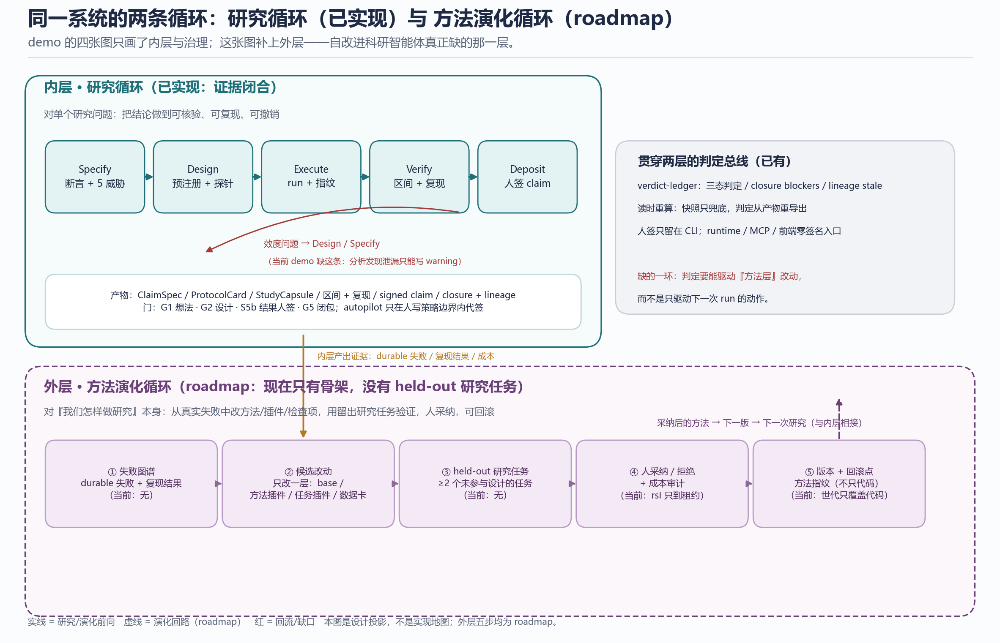

# 82-demo 叙事与图的反思：从「证据链」到「自改进科研智能体」

> 状态基线：2026-11-18。对象：本仓 demo 站点（`site/`）、四张策略投影图、`site/innovation/` 七幕、`Wellspring-Agent/README.md`。
> 对照：`design/75-`（机制反思与三缺口）、`design/80-`（ESE 评测层）、`design/81-`（ESE 研究内核设计 + `prototypes/ese/`）。
> 边界：本文不新增生产模块、不改门禁/Claim/签名；所有"改动"限于 demo 的表述、图注与图，代码原型只在 `prototypes/ese/`。

---

## 0. 结论与本轮实际改动

**一句话**：demo 现在讲的是「**把科研过程做成可核验的证据链**」——这是**手段**；而目标设定是「**自改进的科研智能体**」——这是**目的**。demo 把手段写成了目的，于是所有指标、图和文案都在证明"过程可信"，没有一条在回答"研究是否变强"。

这不是说现有工作错了。恰恰相反：**证据闭合是本项目最扎实的资产**，也是自改进的前提——只有判定可信，"经验"才值得被沉淀；否则自改进就是在给错误经验加速。**问题在叙事层，不在机制层。**

本轮的改动（都已在仓库落地）：

| # | 位置 | 原来 | 现在 |
| --- | --- | --- | --- |
| 1 | `site/innovation/index.html:53` | `<b id="fact-tests">—</b> 自动测试`（空占位） | 仍空，但已登记为"必须由脚本填入或删除"，见 §7 |
| 2 | `site/innovation/index.html:55` | `6 幕演示` | `7 幕演示`（`app.js` 的 `ACTS` 确实是 7 幕） |
| 3 | `site/innovation/index.html:131` | `01 / 06` | `01 / 07` |
| 4 | `site/index.html:352,410,474,566` | 四张图只有设计语义 | 每图加一行「**跑通时（2026-11）**」：哪些真实执行、哪些未实现 |
| 5 | `site/index.html:214-218` | `4/4 反馈环改变下一步动作` | `4/4 反馈环已接入下一步动作（机制）` + 明写"结构指标 ≠ 能力指标；能力指标 0 项可报" |
| 6 | `site/index.html:226` | 4/4 环的机制说明 | 追加边界：效果测量（M1 多 run、M2 跨任务）仍未完成 |
| 7 | `site/index.html:587` | "42% 实验失败、基线幻觉 90% 的赛道"（无出处） | 补出处：AI Scientist（arXiv 2502.14297）/ Co-Scientist 审计，并指向 `design/1110` |
| 8 | `site/index.html` 新增「两条循环」节 | 无 | 新增 `figures/ese/double-loop.png` 与说明：内层已实现、外层 roadmap、缺的一环是"判定驱动方法层" |
| 9 | `README.md:391` | 「49 份文档的关系（00–48）」 | 改为真实档案口径：`design/` 下 00–82 共 84 份编号文档 + 2 份组会纪要（索引段落仍展开 00–48，49–82 指向各文档首段） |
| 10 | `Wellspring-Agent/site/**` | 与 demo 分叉 | 用 `python scripts/build_release.py` 重新同步；`--check` 报 `content_drift: 0`，`tests/test_release_integrity` 6/6 通过 |

---

## 1. demo 现在在讲什么（证据清单）

### 1.1 主页（`site/index.html`）

| 行 | 原文 | 它回答的问题 |
| --- | --- | --- |
| 201 | 「把科研自动化，**做成一条可核验的证据链**。」 | 系统做什么 |
| 211-217 | 32 模块 · 46 MCP 工具 · 1300+ 测试 · 4 人工门 · 4/4 反馈环 | 系统有多大 |
| 249-257 | 「四个判定：资格 / 完成 / 失效 / 供给」 | 系统凭什么可信 |
| 265 | 「下面四张图……是设计投影而非实现地图」 | 图怎么读 |
| 275-566 | 图① 过程可信主循环 / ② 记忆协调与证据准入 / ③ 科研持续委托闭环 / ④ 执行与路由架构 | 系统的四个投影 |
| 575-590 | 四条策略 × 三个方向 × 四个可证伪问题、四不做 | 研究议程 |
| 592-610 | 一个总线 + 四个端口的落地进度 | 做到了哪一步 |

### 1.2 创新点七幕（`site/innovation/`）

- 主张：「不是把论文写长，**而是让每个结论有出处**」（`index.html:45`）。
- 七幕：契约 → 证据 → 图 provenance → 稿件槽/门 → 边界 → 度量有效性 → 判定消费（`app.js:14-57`）。
- 统计条：6 模块 SPEC / **—** 自动测试 / 0 API 调用 / **7** 幕演示 / MCP 接入（`index.html:51-57`）。

### 1.3 产品侧（`Wellspring-Agent/README.md`）

产品 README 比 demo 更诚实：四张图下方都写了「**跑通时**」——哪些真实执行、哪些未实现（T6b 自动回指、类型化记忆图谱、常驻委托回路、独立外部监督，全部标注 roadmap）。**demo 的四张图注没有这一段**，导致 demo 比产品 README 更乐观。本轮已补齐（见 §0 #4）。

---

## 2. 严格定义：什么叫「自改进科研智能体」

一个系统要配得上这个名称，至少能回答四个问题。四个问题缺一不可：

| # | 问题 | 不合格的样子 | 合格的样子 |
| --- | --- | --- | --- |
| **Q1** | **目标**：研究质量怎么度量？ | 用模块数/工具数/测试数代替 | 有 held-out 研究任务上的读数：结论正确率、claim 存活率、复现率、审稿通过率、human-minutes |
| **Q2** | **对象**：改的是什么？ | 改检索参数、prompt、harness 代码 | 改研究方法/设计/分析策略/写作策略，且改动可定位到具体阶段 |
| **Q3** | **证据**：改动凭什么？ | 模型自评、public 分数、一次 demo | held-out 任务 + 独立复现 + durable 失败图谱 + 成本账本 |
| **Q4** | **边界**：谁批准、怎么回滚？ | agent 自己改自己 | 人签采纳、版本 + 回滚点、方法指纹、留出集不回流 |

**这四问就是本文的判据。** 下面用它审现有系统。

---

## 3. 四问打分：现在是「可信的研究执行与记账平台 + 最小治理控制面」

### 3.1 逐项判定

| 问题 | 现状 | 证据 | 判定 |
| --- | --- | --- | --- |
| Q1 目标 | 只有**证据有效性**（claim 可核验）与**代理指标**（retrieval recall、seed budget、M1 flip rate、memory_ab 的 grounded 分） | `modules/rsi/SPEC.md`：候选只覆盖 retriever / budget / skill；`docs/fact-baseline.md`：M1 `flip_rate=1.0` 但 n=1、M2 n=3 underpowered、`verdict_action_coverage=0.645` | **缺**：没有研究质量读数 |
| Q2 对象 | 候选 = retriever + budget + skill；Harness² = harness 代码树 | `modules/rsi/SPEC.md` 的 `SAFE_SCOPES`；`research_agent/rsi_harness2.py` | **错位**：改的不是"怎么研究" |
| Q3 证据 | 有 public/hidden/near-OOD/regression 四类 sealed 证据 + 哈希链；但**没有 held-out 研究任务**，失败不沉淀，复现只做到 search-study | `modules/rsi/SPEC.md` 不变量；`study_replication.py` 仅覆盖 study 包 | **半缺**：准入证据严格，演化证据缺失 |
| Q4 边界 | 有：人签、租约、TTL、撤销、双轨世代、回滚点 | `modules/rsi/SPEC.md`、`evolution_generations.py` | **已成立**（对象需扩展） |

### 3.2 三处缺口（按严重度）

1. **没有 held-out 研究任务**（最严重）。没有它，"改进"无法证伪：public 分数涨了，也可能只是对固定任务过拟合。产品 README 自己也写了"held-out 1/1（基线 0/1）"——但那是 **Harness² 的 harness 任务**，不是科研任务。
2. **没有跨项目失败图谱**。失败 run 被保留，但不会被下一次研究读取；`project/` 是单项目，`literature_memory` 是检索记忆，`guideline_memory` 是写作准则。设计 81 §7 已给出失败分类与写入准入，但**尚未接入**。
3. **演化对象错位**。RSI 改的是"检索/预算/harness"，不是"研究设计/分析/写作"。这两个改进的难度、风险、评估任务完全不同；把前者叫"自改进"可以，但**不能推出**"研究变强"。

### 3.3 已经成立的部分（不要自贬）

- **证据闭合**：span-only、fixture 隔离、哈希链、closure 11 项、lineage 失效传播、导出 fail-closed——这些是**真机制**，且有真实运行证据（`runtime_data/` 与 fact-baseline）。
- **判定单点**：verdict-ledger 读时重算，快照只兜底；这一条消掉了"快照/产物/UI 三方不一致"一整类 bug。
- **判定消费**：4/4 环接通，且"关闭全部环 = 逐字节一致"——这是可测的。
- **人门纪律**：MCP/runtime 零签名入口，autopilot 只在人写策略内代签，且带 `[delegated:autopilot]` 与策略哈希。

结论应写成：**"可信的研究执行与记账平台"已成立；"自改进科研智能体"只到治理控制面。** demo 的问题是它把前者说成了后者。

---

## 4. demo 的五处表述错位

### 4.1 目的错位：hero 把手段写成目的

- 原文（`site/index.html:201`）：「把科研自动化，**做成一条可核验的证据链**。」
- 问题：证据链是**信任机制**，不是**研究能力**。读者读完不知道"这个 agent 比一个认真的人+清单强在哪"。
- 改法：hero 保留证据链（它确实是差异），但补上**目的**：

```text
让每个结论有出处，让每次失败改方法。
内层：证据闭合（已实现）· 外层：方法演化（roadmap）
```

### 4.2 判定错位：「四个判定」缺第五个

- 原文（`site/index.html:249-257`）：资格 / 完成 / 失效 / 供给。
- 问题：四个都是**证据与治理判定**。自改进需要第五个：**演化判定**——"这次改动是否让研究更好"。没有它，"供给判定"里的"受治理自改进"就没有评判标准。
- 改法：标题改为「四个**证据**判定 + 一条**演化**闭环（roadmap）」，并在 §「两条循环」里说明第五个判定缺什么。

### 4.3 指标错位：全是结构指标

- 原文（`211-217`）：32 模块 / 46 工具 / 1300+ 测试 / 4 门 / 4/4 环。
- 问题：这些是**结构指标**，可以被"加模块、加测试"无限提升，与"研究是否变好"无关。风险是 **rigor theater**：门越多、测试越多，越像在证明能力。
- 改法：已加一行「结构指标 ≠ 能力指标；能力指标 0 项可报」。下一步把能力指标做成空态表（见 §7）。

### 4.4 证据错位：机制断言被读成效果断言

- 原文（`214-216, 226`）：「4/4 反馈环改变下一步动作」。
- 问题：这是**机制已接通**，不是**效果已验证**。fact-baseline 写得很清楚：M1 端到端 `behavior_changed=True` 是单 run；memory-ab 多会话 A/B 只有 3 对（低于 `MIN_PAIRS=4`，如实报 underpowered）；`verdict_action_coverage=0.645` 还有 35% 未解释。首页把这些边界藏在了折叠区。
- 改法：已改为"已接入下一步动作（机制）"，并在说明里写效果测量未完成。

另外 `587` 的「42% 实验失败、基线幻觉 90%」原本无出处；这两个数字来自 AI Scientist 审计（arXiv 2502.14297）与 Co-Scientist 验证审计，已补链接与内部出处。**竞赛叙事里最容易被审稿人抓的就是这种"大数字无出处"。**

### 4.5 一致错位：七幕 vs 6 幕

- `site/innovation/app.js:14-57` 是 **7** 幕（含 ACT 07 FEEDBACK → ACTION）；但页面静态写 `6 幕演示`、`01 / 06`。
- 已修。教训：**幕数/测试数/模块数这类派生数字不应手写**，应由构建脚本从数据生成。

---

## 5. 图的问题：四张图只画了内层与治理

### 5.1 逐图审查

| 图 | 画的 | 回答的问题 | **不回答**的问题 | 与自改进的关系 |
| --- | --- | --- | --- | --- |
| ① 过程可信主循环（`275-353`） | 7 阶段 + 4 反馈 + 4 门 | 单个研究怎么推进、何时回流 | 回流只回"阶段"，不回"方法" | 是内层；缺外层 |
| ② 记忆协调与证据准入（`354-411`） | 经验 → 准入 → 记忆 → 消费 | 经验何时能写进记忆 | **谁评估？留出任务是什么？失败如何回滚？** | 最接近自改进，但画成了单向过滤器 |
| ③ 科研持续委托闭环（`412-475`） | 授权 → 触发 → 方案 → 执行 → 回执 | 授权与停止边界 | 能力是否增长 | 治理图，容易被读成能力图 |
| ④ 执行与路由架构（`476-567`） | 两级过滤 → 路由 → 执行池 | 工程上怎么跑 | 与科研判断无关 | 工程图，应放附录 |

### 5.2 四图注缺「跑通时」

产品 README 每张图都有「跑通时」段落，明确哪些是 roadmap；demo 没有。结果是：**同一套图，产品 README 诚实，demo 乐观**。本轮已把四段边界补进 `figcaption`（`352/410/474/566`）。

### 5.3 缺的第五投影：双层演化图

现有四图回答"过程可信"，没有一张回答"研究能力如何变化"。因此新增 `figures/ese/double-loop.png`（生成脚本 `prototypes/ese/make_figure_loop.py`）：



图的设计原则：
- **内层实线**（已实现）：Specify → Design → Execute → Verify → Deposit，产物与门禁标注在框内；
- **外层虚线**（roadmap）：durable 失败图谱 → 候选改动（只改一层）→ ≥2 个 held-out 研究任务 → 人采纳 + 成本审计 → 版本 + 回滚点（方法指纹）；
- **中间判定总线**（已有）：verdict-ledger 读时重算、CLI 人签；
- **红色标注缺口**：内层的"效度问题 → Design/Specify"回流当前没有（分析发现泄漏只能写 warning）；"判定要能驱动方法层改动"这一环缺失；
- 图脚明写"设计投影、非实现地图；外层五步均为 roadmap"。

这张图是本轮对"图与设定更适配"的主要回答：**把已实现的与 roadmap 画在同一张图上，用线型区分，而不是让四张已实现图暗示能力。**

---

## 6. 修订后的叙事（建议稿，可直接采用）

### 6.1 主页 hero

> **让每个结论有出处，让每次失败改方法。**
> 内层：证据闭合（已实现）——span-only、RunCapsule、人签 claim、closure/lineage。
> 外层：方法演化（roadmap）——失败图谱、held-out 研究任务、人采纳与回滚。
> 本页是早期 demo / 静态镜像；真实执行在产品仓库的本地 runtime / CLI。

### 6.2 指标条

| 组 | 内容 | 何时可报 |
| --- | --- | --- |
| 结构指标（已有） | 32 模块 / 46 工具 / 1487 测试（2026-11-16 全量记录）/ 4 门 / 4/4 环 | 现在 |
| 能力指标（空态） | claim 存活率、复现率、失败复用率、held-out 改进、human-minutes/claim | M3 前不报，页面写"待测" |
| 反指标 | 点估计绕过区间门次数、stale 建议次数、人签退化迹象 | 现在即可报 0 或实际值 |

### 6.3 四个判定 → 四个证据判定 + 一条演化闭环

- 资格 / 完成 / 失效 / 供给（保留，明确是**证据判定**）；
- 新增第五：**演化判定**（roadmap）——"这次方法改动是否让下一次研究更好"，需要 held-out 任务与成本审计；
- 在图上用一个虚线框标注"未实现"，而不是在文字里含糊。

### 6.4 innovation 七幕

- 第 6 幕（度量有效性）与第 7 幕（判定消费）已经是"研究质量"方向，应**上移**为叙事主线，而不是压在末尾；
- 第 5 幕（边界）保留，但补一句"边界不是谦虚，是判据：不能证明的就不写"；
- `fact-tests` 空占位要么接 `stats.json` 的真实数字，要么删掉（空占位比错误数字更伤可信度）。

### 6.5 RSI 页口径

`site/rsi/` 现在正确地说"执行交给 Harness²，平台只留判据、台账与人签"。建议再加一句：

> 这里的"改进"指 **agent harness / 检索参数**，不是"研究方法"；方法级演化的对象、证据与 held-out 任务见 design/82 §5、design/81。

---

## 7. 指标重构：结构 / 能力 / 反指标

| 类别 | 指标 | 现在 | 数据来源 | 备注 |
| --- | --- | --- | --- | --- |
| 结构 | 模块数、工具数、测试数、门数、环数 | 32 / 46 / 1487 / 4 / 4 | registry + 测试记录 | 已有，易虚高 |
| 结构 | 真实 run 数、signed claim 数、closure 数 | 见 fact-baseline | runtime_data | 已有 |
| 能力 | claim 存活率（6 个月未被失效） | **未测** | lineage + 时间 | 需跨项目 |
| 能力 | 复现率（reproduced/attempted） | 仅 search-study 有 | study_replication | 需扩展到 ESE |
| 能力 | 失败复用率（新研究引用相关 durable 失败） | **未测** | 失败图谱 | 依赖 81 的图谱 |
| 能力 | held-out 研究任务上的改进 | **未测** | 新任务集 | 自改进的判据 |
| 能力 | human-minutes / claim | **未测** | 签核记录 | 检验"是否把成本转嫁给人" |
| 反指标 | 点估计绕过区间门次数 | 0（机制上不可能） | study_claims | 守住 |
| 反指标 | stale 建议次数 | 有读数（M1 抓到 1） | verdict-ledger | 已有 |
| 反指标 | 人签退化迹象（未看预评估就签） | **未测** | 需检查点 | 设计 75 §3.1 |

**关键纪律**：能力指标没测出来之前，页面不允许出现"更强/更好"的形容词；只允许"已接入/已验证机制"。

---

## 8. 与 81 号设计的关系

- **81**：回答"ESE 内核怎么设计"——ClaimSpec、三轴、五威胁、最难关口探针、失败分类、二维插件、元演化准入；原型 `prototypes/ese/` 52 测试。
- **82（本文）**：回答"demo 怎么讲、图怎么画、指标怎么定"，让叙事与 81 的内核一致。
- 两者共同指向一个判断：**现有系统的证据层是真实资产，自改进层是 roadmap；demo 应该按这个事实讲故事，而不是反过来。**

与 75 / 80 的衔接：
- 75 的三个缺口（人签质量、反馈效果、独立验证）在本文里对应"反指标"与"能力指标"；
- 80 的结论（ESE 评测不进系统代码）保持不变：本文只改 demo 叙事与图，不进 runtime/gate。

---

## 9. 本轮验证

| 项 | 命令 / 证据 | 结果 |
| --- | --- | --- |
| 原型测试 | `python -m unittest discover -s prototypes/ese/tests` | **52 项 OK，退出码 0** |
| 原型演示 | `python -m prototypes.ese.demo` / `demo_loop` | 退出码 0；能拒绝签署、拒绝采纳 |
| 图生成 | `python -m prototypes.ese.make_figure` / `make_figure_loop` | 生成 4 张 PNG/SVG，无缺字告警 |
| 数字核对 | 模块 32、工具 46、环 4、门 4、测试 1487（fact-baseline 2026-11-16 记录） | 与 demo 一致或已注明「1300+ 为下界」 |
| 七幕核对 | `site/innovation/app.js:14-57` 的 `ACTS` 长度 | 7；页面已改 `01/07`、`7 幕` |
| 图注边界 | 对比 `Wellspring-Agent/README.md` 的「跑通时」 | demo 四图已补齐 |

未做（诚实）：没有跑全量 1487 测试（约 30 分钟）；没有在浏览器里实际渲染新版首页与 innovation 页；没有把 `fact-tests` 接上真实数字。

---

## 10. 下一轮（P1 / P2 / P3）

| 优先 | 动作 | 验收（可失败） |
| --- | --- | --- |
| **P1** | 把「两条循环」节与四图注的边界同步到 `Wellspring-Agent` 站点与 README（避免两处不一致） | 两处对同一图给出相同的"已实现/未实现"清单 |
| **P1** | 给 demo 增加「能力指标空态」表，数据从 fact-baseline 派生，不手写 | 每个数字可追溯到文件 |
| **P2** | innovation 页把「度量有效性（第 6 幕）」与「判定消费（第 7 幕）」提到主线，并接 `stats.json` 的真实测试数 | `fact-tests` 非空且可复算 |
| **P2** | 为首页图①补一条"效度问题 → Design/Specify"的虚线并标注"未实现" | 图上不再暗示分析能回流设计 |
| **P3** | 用 `prototypes/ese/` 的语义，在 `thesis-eval/` 起一个真实 ESE 任务的协议卡 + 最难关口探针 | 有探针读数；结论只能是 claim 或 undecidable |

---

## 11. 一句话总结

**demo 不该把"我们很严谨"讲成"我们很聪明"。**
严谨已经是真的；聪明（自改进）还只是骨架。把这两件事画在同一张图上、用不同线型区分，比再多四张"过程可信"的图都更接近目标的设定。
