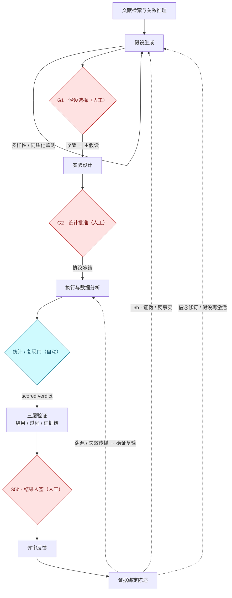
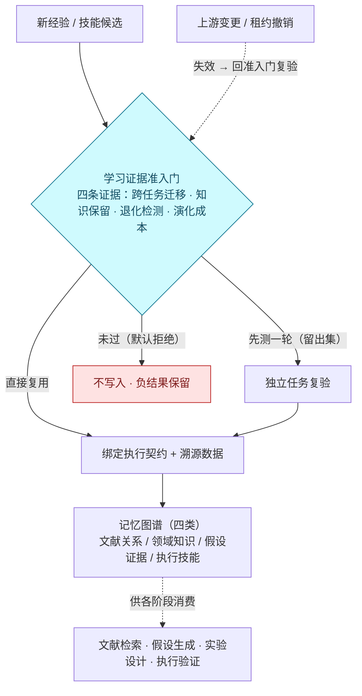
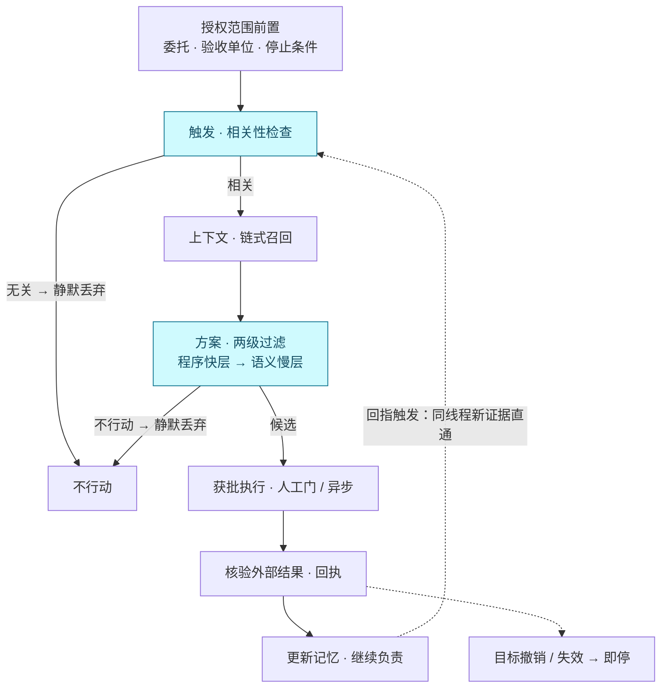
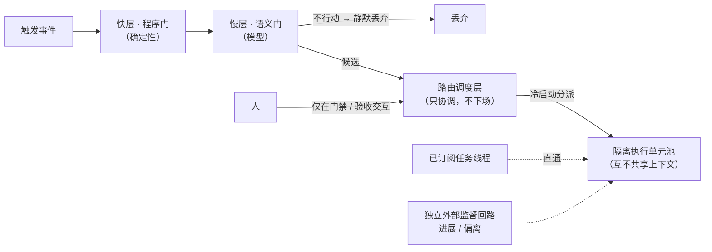

# 科研智能体：可审计科研运行时

> 一套证据可审计、能力可插拔、可被 Qoder / Claude Code / Zcode / HTTP / Python 调用的科研运行时。  
> 不是“全自动投稿机器”；人工门由人签，或由人写一次 `autopilot-policy.json` 后由 `autopilot` 在边界内代签（签名标 `delegated`、带策略哈希），投稿仍然不做。

> **项目定位**：本仓库（`research-agent`）是**早期 demo / 展示项目**——策略论证页、七幕创新演示与静态镜像；智能体产品在 [`Wellspring-Agent`](https://github.com/Yangxc0414/Wellspring-Agent)（打开前端即工作台 + CLI + MCP）。两者是不同的产品，开发一律以产品仓库的定位为准。
> **证据状态（2026-10-31，读任何搜索研究结论前先看）**：首要指标
> `improvement_per_evaluation` 数的是**改进事件**，底层 accuracy 有 1.0 上限。新种子 65–96 的
> 64 种子预注册扩样（97–160）显示：memory×archive 交互在 raw 计数上 **4/4** 复制，但
> headroom-normalized AUC 交互 **0/4** 判定；breast/iris/wine 的 AUC 上界低于 raw 效应量级，
> digits 经 96 种子合并后只是 borderline（AUC 上界 0.1378 vs raw 0.1403）。因此效应量是**度量依赖**的，
> 下文所有基于该指标的历史交互结论（包括 memory×gate 的 64 种子结果）只能作为
> **度量特定的测量结果**，不能读成搜索效率或机制。复现命令：
> `python -m research_agent study saturation --study-dir <package>`；面向真实结果的 CCF-A 设计见
> [`runtime_data/qoder-real-lit/study-design-metric-validity.json`](runtime_data/qoder-real-lit/study-design-metric-validity.json)
> （审计 `attention / evidence_ready`）。

## 先看这五个入口

| 入口 | 回答 |
| --- | --- |
| [`QUICKSTART.md`](QUICKSTART.md) | 10 分钟怎么跑起来；MCP、revision、AstraDraw、HTTP 最小命令 |
| [`ARCHITECTURE.md`](ARCHITECTURE.md) | 哪些是稳定内核、哪些可扩展、当前实现到什么程度 |
| [`integrations/README.md`](integrations/README.md) | Qoder / Claude Code / Zcode、人工门与项目目录 |
| [`integrations/FRAMEWORKS.md`](integrations/FRAMEWORKS.md) | LangGraph / CrewAI / AutoGen / HTTP / Python SDK |
| [`modules/README.md`](modules/README.md) | 模块 SPEC、扩展点与新模块流程 |

## 研究策略与流程图（1110 组会论证口径）

一句话主张：**不做端到端「自动写论文」**——做两件事：**让过程可信**，**让判定真正改变下一步行动**。验收单位从「一篇论文」改成「一段时间里，科研委托有没有办完：签署、核验、维护」。新颖性只落在四处：**证据链复现 · 失效传播 · 判定消费 · 学习证据准入**；度量与门间自动化借鉴外部成熟契约（ARS / CCFA），不重造。

下面四张图是**同一系统的四个投影**，不是实现地图；建议按 ③ → ① → ② → ④ 读。图例：红色 = 人工门（G1 想法选择 · G2 设计批准 · S5b 结果人签 · G5 闭包签署），青色 = 自动门（默认拒绝），虚线 = 反馈环（回指更早阶段且改变下一步动作）。彩色 SVG 原图见公开站 [`site/index.html`](site/index.html) 的「DESIGN / 系统投影」区。

### 图 ① 过程可信主循环（策略① / 方向 B · 守内核）

七个阶段、四条反馈环、四道门。反馈（证伪 / 反事实、信念修订、溯源 / 失效传播）都**回指更早阶段并改变下一步动作**，不是只写反思文本；「假设生成」的自环是多样性 / 同质化监测。



### 图 ② 记忆协调与学习证据准入（策略③ / 方向 A · 第一切口）

不研究「生成更多技能」，研究**已验证的技能什么时候能安全用到新任务**：直接复用、先测一轮、还是拒绝。未过准入门一律默认拒绝；上游变更触发失效并回指准入门复验。



### 图 ③ 科研持续委托闭环（验收单位 · 授权 · 停止条件）

授权范围前置，人只在门禁与验收交互；过滤层判定不行动时**统一静默丢弃（默认拒绝）**；目标撤销 / 失效即停。



### 图 ④ 执行与路由架构（控制面 / 执行面分离）

路由层只协调不下场；执行单元隔离上下文，过程可复现、评审可独立；独立外部监督盯实质进展与目标偏离（非仅进程存活）。



### 四条策略 → 方向 → 可证伪验证入口

| 策略 | 对应方向 / 问题 | 内容 | 可证伪的验证入口 |
| --- | --- | --- | --- |
| ① 过程可信底座 | 方向 B · 守内核 | 三层可验证 + 溯源数据 + 失效传播 | 留出集改上游，看能否推准失效范围；对照只防篡改的系统 |
| ② 反馈 → 行动 | Q2 · 第一个诊断实验 | 五类反馈（真实 / 打乱 / 过时 / 含噪 / 矛盾）对照行动变化 | 反馈敏感性与信息价值一致 → 切口不成立 |
| ③ 学习证据准入 | 方向 A · 第一切口 | 技能适用域与负迁移控制 | 全存 / 全不存 / 重放后存 / 独立验证后存，四存储策略对照 |
| ④ 多样性 + 证伪 | 方向 C · 后续前沿 | 群体同质化监测 + 反事实 / 信念修订 | 跟踪多轮方向分布 / 新颖度 / 重复率，对照有无探索约束 |

顺序：**B 守内核，A 做第一个切口，C 放后面**；②始终作为诊断实验贯穿。四个可证伪评测问题：Q1 指标收益与独立证据是否脱钩（优先预实验）、Q2 反馈何时真改变行动、Q3 一次成功何时值得沉淀为经验、Q4 自主循环是否越走越窄。

### 研究里程碑（每步带可失败的验收）

| 里程碑 | 研究动作 | 可失败的验收 |
| --- | --- | --- |
| M0 | 内核口径校准：最小证据闭合实例 + 失效复核 | 实例不能签署或变更不锁导出 → 口径重述 |
| M1 | 第一个诊断实验：五类反馈对照（Q2） | 反馈敏感性与信息价值一致 → 切口不成立 |
| M2 | 方向 A 预实验：四存储策略 + 方向 B 失效探针 | 原任务成功能预测跨任务收益 / 探针无漏报差异 → 无增量 |
| M3 | 论文撰写 + 外部 / 专家评审 | — |

**四件不做的事**：不追端到端生成（独立审计 42% 提议实验失败、端到端基线严重结果幻觉 90%，赛道拥挤无差异化）；不重造度量（ARS / CCFA / MLR-Bench 已把统计口径做成机器契约，借来用）；不照搬静态 skill 目录（静态格式不是运行时证据）；不放开无约束自主执行（人工门留在假设选择、设计批准、签署三处，自动化只跑门与门之间）。

## 开源交付与安全

| 文件 | 作用 |
| --- | --- |
| [`LICENSING.md`](LICENSING.md) | 许可证决策记录与发布前检查；**当前根 `LICENSE` 尚未选定，因此还不能对外宣称已开源授权** |
| [`SECURITY.md`](SECURITY.md) | API key 只走环境变量、本地实验/外部 Skill/MCP/HTTP 的执行边界与漏洞报告方式 |
| [`CONTRIBUTING.md`](CONTRIBUTING.md) | SPEC-first 工作流、模块版本规则、离线测试与外部适配器规则 |
| [`THIRD_PARTY_NOTICES.md`](THIRD_PARTY_NOTICES.md) | AstraDraw、PyMuPDF、外部 Skill、研究快照与模板素材的许可边界 |
| [`scripts/release_check.py`](scripts/release_check.py) | 发布面自检：交付文档、`.gitignore`、密钥与本地绝对路径泄漏 |
| [`scripts/setup_mcp.py`](scripts/setup_mcp.py) | 一键生成当前 checkout 的本机 `.mcp.json`；拒绝覆盖已有配置，支持 `--print`/`--force` |
| [`scripts/doctor.py`](scripts/doctor.py) | 本地环境自检：Python/MCP 启动器/Node/可选依赖/外部 Skill/key 存在性；不打印 key 值 |
| [`.github/workflows/ci.yml`](.github/workflows/ci.yml) | CI：发布面自检 + 离线 Python 全测 + 前端 typecheck/unit/build |

```bash
# 当前仓库：0 blockers；未选定 LICENSE 等作为 warning 显示
python scripts/release_check.py

# 首次公开发布前：缺 LICENSE / 包元数据 / 忽略规则会直接阻断
python scripts/release_check.py --for-public-release
```

## 平台与 RSI 基础设施的分工（2026-11-10 组会口径）

本仓库是**科研智能体平台**：负责模块契约、证据与产物、数据基础，以及自改进的**判据**（准入理由 / 租约 / 撤销传播 / 留出增益）。RSI 基础设施是可委托的相邻课题，边界如下。

| 归属 | 负责什么 | 当前状态 |
| --- | --- | --- |
| 本平台 | 六模块 SPEC、artifact、span-only 证据、claim / closure、四道人签门 | 已实现（fixture 纵切 + CC-BY 语料 probe） |
| 本平台 | 自改进判据：EV1–EV4、租约、撤销传播、MetaTracker、`harness2-run-0.1` 接缝与 conformance | 控制面已实现；真实 evaluator 未接 |
| 外部执行（Harness²） | Propose–Probe–Compose 递归、c1..c8 组件面、平行 / 顺序两种模式、R=4k / P=3k 预算 | 已接通并实跑（确定性夹具，`simulation=true`）；真实模型执行器是 roadmap |
| 可委托 RSI 基础设施 | 流水线编排与重试、阶段 checkpoint、版本 / 回滚、细粒度反馈（知识原子级冲突与污染）、评测调度 | `harness2.harness` scope 已登记；其余仍是 roadmap |
| 两边共用 | MCP / HTTP / CLI 三入口与 `framework_api.dispatch` | 已实现 |

接缝怎么跑（需要 Python 3.12/3.13，平台本身仍是 3.8）：

```bash
python -m research_agent.cli rsi harness2 probe      # 探针：checkout、解释器、桥、补丁
python -m research_agent.cli rsi harness2 run --k 2 --mode both --adapter science
python -m research_agent.cli rsi harness2 status     # 契约 / 预算 / 任务 / 分类自检
python -m research_agent.cli rsi harness2 record     # 只写 pending_human，不 admit
```

平台不导入 Harness²（它是 3.12-only）：`scripts/harness2_run.py` 在独立进程里跑，回传 `harness2-run-0.1`。Windows 上两个便携性补丁（`fcntl.flock`、`tree.read_tree` 的 POSIX 路径）会写进产物，跑出来的结果不会被误当成上游 POSIX 行为。

### 自进化本身的版本管理（agent 轨 + platform 轨）

自进化跑出来的东西也要能回滚、能对账，所以平台把「哪版代码 + 哪版 harness 产出了哪份证据」记成两条链：

| 轨道 | 版本标识 | 记什么 | 命令 |
| --- | --- | --- | --- |
| agent | 采纳 harness 树的 SHA-256 | 树、episode、public/hidden 摘要、跑在哪版平台 | `rsi gen agent` / `rsi harness2 record --generation` |
| platform | `research_agent/**/*.py` 的 16 位指纹 + commit/备注 | 平台代码状态；新状态自动把上一条标记 `superseded` | `rsi gen snapshot` |

两条链靠 `platform_fingerprint` 关联：平台一变，旧 harness 世代会被 `rsi gen verify` 点名要求复验（`stale_agents`），但**不自动撤销租约、不改 claim**——降级与复验是人的动作。同一棵树在新平台上重测会自动把旧记录标成 `superseded`，所以"复验"不会被显示成"新改进"。

```bash
python -m research_agent.cli rsi gen list          # 两条链
python -m research_agent.cli rsi gen verify        # 链完整性 + 跨轨耦合
python -m research_agent.cli rsi gen snapshot --label "..." --commit <sha>
python -m research_agent.cli rsi gen propose --label "..." --patch fix.patch  # 只记录，不应用
```

边界：指纹只覆盖 `research_agent/**/*.py`，只改 SPEC/文档不会移动它；台账不存源码、不 apply 补丁、不签名，`propose` 只记 `git apply --check` 的结果。

不宣称：不把「内置最小 RSI 控制面」说成「已完成与 RSI 基础设施对接」；不训练模型权重；人签门始终在平台侧，不能由基础设施或模型代签。确定性夹具跑通只证明接口与治理映射，不证明能力增益；验证路线是小数据集 + DeepSeek 基座 + 论文投稿反馈场景，先证明「判定能改变下一步动作」，再谈能力增益。

## 当前事实基线（摘要）

> 完整台账（逐项读数、推翻与复现记录、度量口径）见 [docs/fact-baseline.md](docs/fact-baseline.md)。本节只保留"读代码前必须知道的事实"，细节一律以台账为准，避免两处漂移。

- **证据闭合**：span-only 资格判定、RunCapsule/EA 完成判定、lineage 失效判定、供给判定；claim 只能由人签（或人写策略授权的 autopilot 代签，带 `[delegated:autopilot]` 与策略哈希）。
- **人工门**：G1 想法选择 · G2 设计批准 · S5b 结果人签 · G5 闭包签署；MCP / HTTP / 前端零签名入口。
- **接口面**：46 个 MCP 工具（以 `tools/list` 为准），MCP/HTTP/Python 共用 `framework_api.dispatch`。
- **研究臂**：`study` 的声明式因子设计 + 95% 区间门 + 跨数据集复现计数；区间跨零即报 undecidable，不用点估计冒充方向。
- **反馈**：4/4 环已接入下一步动作（机制层，默认关闭、逐环开启）；效果测量（M1 多 run、M2 跨任务）仍未完成。
- **自进化**：`rsi` 是受治理控制面（候选 / 租约 / 撤销 / 双轨世代），演化对象仍限于检索参数与 harness，不是研究方法；方法级配方演化见 [design/83](design/83-研究记忆图谱与三轴自改进闭环.md)。
- **诚实边界**：fixture 结果不是证据；点估计不是方向；"跑通"不是"能力增益"；未实现项写在 roadmap，不写成"已支持"。
- **测试读数**：全量离线套件以最近一次记录为准（见 fact-baseline 的"全量测试读数"条目），不在 README 手写会漂移的数字。

## 在线 Demo

- 前端工作台：**https://yangxc0414.github.io/research-agent/app/**
- 主站：**https://yangxc0414.github.io/research-agent/**
- 创新演示：**https://yangxc0414.github.io/research-agent/innovation/**
- 说明：GitHub 上是**前端镜像仓库**（`pages-repo/`），静态模式运行、不调用 runtime、不包含后端；主项目仓库仍未推送。部署镜像与验证记录见 `43-GitHub-Pages部署与前端镜像.md`。

本目录包含三部分工作：对组内初稿《科研智能体 Taxonomy 树》的**逐篇核验 + 重组**，在此之上形成的**产品需求与流水线设计**，以及与 **Google Co-Scientist / ScientistTwo / OpenRSI / PaperBenchX / 开源系统 / 2026 RSI 家族**的逐项对照。文献部分回答组会上的四个问题：

1. **什么方向值得去做？**
2. **什么方向有前景？**
3. **什么问题别人已经做过了？**
4. **什么问题还没被做？**

产品部分回答：**做什么、怎么做、要几个人**；全流程对照回答：**文献调研、Idea 收敛、实验设计、绘图、写作如何串成一条可审计的链路**。另附 `19–26` 八份推进文档：RSI 运行纪律反思、开源科研 Agent 框架与技术栈调研、可落地系统设计（含 DeepSeek 接入、Skill 下载/自进化与论文产出）、可扩展工程架构、开源自改进机制对照（Lease-Gated Runtime），底座/AstraDraw 集成的工程优势与反思、受治理 RSI 的长期路线与控制面实现，以及免训练 RSI 的论文机制调研与 TF-RSI 路线。

---

## 文件结构

```
毕业设计/
├── README.md                                        ← 你在这里
├── 00-Literature-Review-组会汇报.md                 ← 文献主报告（先读这个）
├── 01-组会纪要-核心判断与优先方向.md                ← 五个判断 / 两条主线 / 三个方向
├── 02-需求书-科研自动化与写作平台.md                ← 产品定位、功能、团队与毕设招募
├── 03-调研留痕-市场竞品与研究依据.md                ← 市场/竞品/研究证据清单
├── 04-自动化研究与写作流水线.md                     ← 端到端流水线、质量门与评测设计
├── 05-全流程设计与Co-Scientist对照.md               ← Co-Scientist / ScientistTwo 解剖、01 流程盘点、差距与改进
├── 06-文献阅读技能与综述流程.md                     ← 文献阅读技能调研、S1 七步流程与 claim 级阅读契约
├── 07-复现级验证与执行Harness设计.md                ← RWVH：独立 Work/Judge、干净重跑、R/W/J 与 RWJT
├── 08-反思与差异化工作方案.md                        ← 二次反思：RWJT/证据闭合任务、创新栈、可宣称边界、C1–C4 与论文/产品双轨道
├── 09-系统架构与流程编排设计.md                      ← 一个内核/两条轨道/五类流程：分层、Agent 角色、门禁、调度与五类流程编排
├── 10-RSI与自进化反思-科研改进的准入与证据闭合.md    ← Dream-RSI / Karl / RSIAgent / MASS / SkillCAT / RSI-Anything：七类缺陷、我们的接缝与不可宣称
├── 11-自进化循环设计-准入理由、跨循环继承、迁移与能力增益.md ← 四问门 EV1–EV4、租约、护照、撤销传播、能力归因与 E7/E8
├── 12-RSI-Anything深读-执行契约、保留层与领域不对称.md ← 逐文件深读：run identity/receipts、四种 retain、2×2、conditional confirmation、E/C/A 层
├── 13-创新点评审与主张收敛-需求对齐、开源对照与验证顺序.md ← 主贡献/支撑/扩展/工程四层收敛、开源交集、需求对齐与 C2→C3→C1/C4→E7/E8 验证顺序
├── 14-产品差异化与Demo反思-从证据链写作到证据运营工作台.md ← 证据链商品化后的产品重定位：RWMT、六个缺失对象、六个回路、Demo 2.0 三幕与 12 周落地
├── 15-2026年9-10月调研补充与证据工作台实现.md ← SoL-Pi / TruthInsightBench / BenchShield / OpenScience / OpenAI4S 对照；Evidence Debt、双轴审计与 #workbench 实现记录
├── 16-科研Skill生态调研与动态流程编排.md ← 高 star 科研 skill 的渐进加载/固定 recipe 反思；能力图、任务编译、技能运行时与证据权限
├── 17-基于Skill契约的上层微服务架构.md ← 十个 bounded context 的边界/事件、服务内六边形分层、五个可插拔端口与三 deployable MVP
├── 18-GitHub Pages部署与多智能体Skill设计.md ← 三平面部署、真实公开检索、1+4+人 Agent 契约、Pages 站点与 Actions 预计算；§5.9 记录 1440/1024/768/390/320 的可用性回归、快捷键、移动端阶段导航与细粒度交互修复
├── 19-RSI出题规范对照-自进化运行纪律反思.md ← 固定实例/租约控制器/评测可见性/候选步账：对照 RSI 出题规范补我们的运行面
├── 20-开源科研Agent框架调研-浙大SciToolAgent与主流技术栈.md ← 浙大/西湖归属澄清、框架地图、前后端技术栈、工程反模式与可借用/不借清单
├── 21-可落地系统设计与DeepSeek集成-证据闭合论文产出与Skill自进化.md ← React/TS + FastAPI + Postgres/Redis + Docker + DeepSeek 的完整实现设计：S0–S16、API/SSE、Skill 安装/租约/自进化、论文产出与评测；§9.9–§9.13 分阶段自改进，§9.14 并发多智能体，§9.15 论文-实验双轨，§9.16 实验证据采集/入稿，§9.17 中文期刊/英文会议/学位论文/基金的 WritingProfile 与 skill 路由
├── 22-可扩展工程架构与论文创新点-从Demo到可维护证据运行时.md ← 模块化单体/六边形/端口、四条不变量的代码强制、扩展任务评估与“系统贡献”表述；明确代码整洁本身不是创新
├── 23-开源自改进机制对照-从A-Evolve-RSI-Anything到我们的Lease-Gated-Runtime.md ← 逐项对照 RSI-Anything / AutoResearchClaw A-Evolve / ARIS / AutoResearch / DeepScientist / CycleResearcher；定义自改进的 observe→candidate→dry-run→public/hidden→EV→lease 运行链
├── 24-科研智能体底座与AstraDraw集成-工程优势与反思.md ← SPEC 驱动模块、fixture 纵切、SVG 审计、AstraDraw 集成与 Workbench；与现有工作的工程差异、H1–H4 假设和未完成边界
├── 25-受治理的RSI-从研究执行到元改进追踪.md ← 研究执行环/改进环/元 RSI 环；StepLedger、dry-run、public/hidden、人签、lease、revoke、MetaTracker；明确 evaluator 未接
├── 26-免训练RSI-论文机制调研与实现路线.md ← RRSI/DGM/SICA/SIFT/GEPA/ACE/MASS/ReasoningBank 对照；frozen-model harness RSI、archive/regularized selection/OOD/forgetting、TF-RSI 路线
├── 27-创新逻辑对账-从全部设计文档到底层实现.md ← 00–26 的创新主张→机制→落地点→证据→缺口；innovations.json 与 verify 脚本；工作台“创新逻辑”视图
├── 28-仓库全量技术反思-从证据链到受治理Harness.md ← 全链路审计：能跑什么、哪些只是结构、代码级 P0/P1、前端三套界面反思与改进步
├── 29-多模型接入-OpenAI-Anthropic-API密钥与思考参数设计.md ← Model Gateway：Provider/Profile/Binding、环境变量/session key、推理强度/token 预算翻译、runtime API 与模型接入页
├── 30-自进化与RSI百篇调研-机制证据与治理.md ← 100 篇自进化/RSI 文献（2022–2026）的五簇地图、16 篇深读、证据缺口与 P0/P1/P2 路线
├── 31-对话式科研Agent-静态工作台设计与交互.md ← 单页任务客户端：新的任务/搜索/工作区/最近任务、全自动人工门、自进化、左下角工具/版本/个性化、未来 API adapter
├── 32-前端模型设置-上下文压缩-最大上下文-回复长度与思考强度.md ← 模型能力/平台策略分层、Codex 式离散思考滑块、上下文压缩与 Profile 能力字段
├── 33-运行中对话指导-人机协作执行机制.md ← 执行中插话→GUIDANCE 队列→检查点应用；暂停/继续/单步/签核；不改 claim/EA/gate
├── 34-插件与MCP接入-GitHubMCP与受控工具调用.md ← MCP server 插件、GitHub MCP 预设、按对话启用、工具调用逐次审批、UNTRUSTED 结果
├── 35-前端工程化架构-可部署的对话式科研工作台.md ← Vite/React/TS 工作台、adapter/state 分层、全屏设置、使用统计（热力图/趋势/模型用量）、字体缩放、各模型 Token 用量、多智能体编排与文献记忆、手动 advisory 子智能体、自进化开关、Wellsring 字标背景、对话创建/本地 SKILL.md 导入、后端技能目录与风险标记、字号与框体密度、paths/storage/orchestration 包结构、Docker + Nginx + Pages 构建；静态 adapter 与 runtime 接入边界
├── 36-全闭环创新审计与差异化-证据沿袭与变更闭合.md ← 全阶段真实度审计、Run-bound claim/closure/RSI 边界、真实 ChemLab 签署链、lineage/change-impact 招牌能力、竞品定位与 P0–P2 路线
├── 37-前端全量体验审计-截图与交互逻辑.md ← 参考桌面 Agent 壳的淡蓝工作台：任务列表/快捷入口/个人栏、欢迎页 + 居中会话入口、模型与权限选择、快捷键录制/冲突检测/持久化、可展开阶段轨与当前阶段蓝点、10 个 Skills、S1 六面向覆盖审计、S2 假设收敛、Markdown 回答渲染、任务/工作区删除、四模式、写作槽位、文件夹工作区、右侧上下文收缩、设置中心 16 分组与记忆/子智能体/命令/执行环境/归档、本地文件预览窗、存储位置（浏览器/本地文件夹）、RSI 账本故事、多供应商模型目录、多智能体 fan-out 与文献记忆、手动子智能体与自进化开关、可拖动思考强度、Wellsring Agent 字标背景、对话创建/导入 Skill、工作区文件浏览器、欢迎页上下文“+”菜单、59 类逻辑矛盾与剩余风险
├── 38-AGENT4SCI启发-评估隔离、方法分类与探索管理.md ← 复现基线、Improve/Evaluate/Audit 三阶段隔离、过程审计、验证选择压力、工程 vs 领域干预台账、成本与探索收窄；EVAL 面板与四个研究治理 Skills 的实现与未宣称边界
├── 39-系统级反思-真实可用性、后端缺口与差异化边界.md ← 证据治理原型与演示壳的真实差距、P0 完整性缺口、市场差异化与答辩口径
├── 40-Claude-Code对照-命令技能权限与工作台分层.md ← Command/Skill/Agent/Hook/Plugin/Permission 分层；按需 Skill、`/` 命令菜单、只读权限修复与剩余边界
├── 41-前端反思与设计-从演示壳到研究工作台.md ← 证据工作台设计：任务头/对话/案卷/Composer、字号下限、语义色、Evidence Ledger、移动端与实施顺序
├── 42-后端反思与创新路线-从对象接线到可验证证据运行时.md ← 后端完整性 P0、内容寻址变更传播、语义支持/abstention、sealed hidden、typed RSI、12 周路线与可宣称边界
├── 43-GitHub-Pages部署与前端镜像.md ← 线上地址、pages-repo 结构、静态模式、Pages 部署/验证、已知边界与更新流程
├── 44-Anthropic-Subagent-Loop反思-单Loop与证据治理.md ← 单 Loop + 渐进披露 skills/tools、subagent 保留/折叠清单、Review Pack、评估先行迁移与证据治理边界
├── AGENTS.md                                        ← 后续编码规则：先读/改模块 SPEC.md，最小 diff，测试与 Changelog 同步
├── research_agent/                                  ← 可运行纵切：SpecStore + literature/idea/experiment/run/figure/paper/grant + SVG + Workbench
│   ├── vendor/astradraw/                            ← 完整复制自本地 AstraDraw；上游无根许可证，本地只读
│   ├── runtime/                                     ← 本地 FastAPI：pipeline job / SSE / artifacts / 只读 RSI / model gateway
│   ├── models/                                      ← OpenAI / Anthropic / 兼容端点网关；密钥只进 env 或 runtime 内存
│   └── web/                                         ← 静态 Module Workbench（fixture/真实 run 快照）
├── research/self-evolution-100/                     ← 百篇调研底账：bibliography.json（100 条元数据）+ catalog.md（可读目录）
├── research/anthropic/                              ← Anthropic 官方文章 + single-agent-loop-kit / skills / Agent SDK / quickstarts 快照；README 记录 commit 与许可证
├── single-loop/                                     ← 按 single-agent-loop-kit Step 0 产出的 inventory 与迁移计划；baseline 尚未 scored
├── modules/                                         ← 每个子智能体一份 SPEC.md（唯一契约源；CLI 可读/最小更新/定点 patch）
├── oss/                                             ← 11 个快照 + 3 个策展技能快照 + 完整 clone / 工作树归档
│   ├── README.md                                    ← 版本、入口、能力矩阵与我们的差异
│   ├── metadata.json                                ← commit / 许可证 / SHA-256 / 文件数
│   ├── full/CLONES.md                               ← 完整 git clone / 完整工作树归档 / 中断副本的逐仓清单
│   └── writing-skills/CLONES.md                     ← 中文期刊/英文会议/学位论文/基金写作 skill 的完整 clone 清单
├── figures/                                         ← 可编辑配图
│   ├── preview.html                                 ← 图 1 / 图 2 预览页
│   ├── fig3-preview.html                            ← 图 3 Research Agent 总览预览页
│   ├── fig1-survey-framework.pptx                   ← 图 1 研究框架（可编辑）
│   ├── fig2-calm-method.pptx                        ← 图 2 CALM 方法（可编辑）
│   ├── fig3-evidence-ops-overview.svg / .png        ← 图 3 证据闭合 → 证据运营（矢量 / 位图）
│   ├── build-fig3-evidence-ops.js                   ← 图 3 生成脚本
│   └── README.md                                    ← 图的科学口径与重建说明
├── papers/                                          ← 逐篇论文卡片（五字段）
│   ├── 00-元数据核验表.md                           ← arXiv 原始元数据（完整作者列表）
│   ├── 01-T1-文献检索与关系推理.md
│   ├── 02-T2-假设生成与探索.md
│   ├── 03-T3-实验执行与仪器.md
│   ├── 04-T4数据分析-T5评审-T6复现.md
│   ├── 05-T7端到端与L2系统组织.md
│   └── 06-L3基础设施与工程生态.md
├── apps/web/                                        ← 可部署工作台源码：Vite + React + TS + Zustand；桌面 Agent 壳、欢迎页、四模式、访问级别、快捷键设置、Skills、EVAL 评估隔离、文件夹工作区、写作槽位、结构化回答、模型/插件/指导、手动子智能体与自进化开关、Wellsring 字标背景、对话创建与本地 SKILL.md 导入、工作区文件浏览器
├── deploy/                                          ← 全站 Docker 镜像：Node 构建 app + Nginx 托管 + /api 反向代理模板
├── site/                                            ← GitHub Pages 单屏应用壳 + Agent 工作台：研究运行/证据/自进化/功能地图/检索/部署/文档
│   ├── index.html / assets/                         ← 主页、base/theme/custom 样式、交互、OG 图
│   ├── data/                                        ← queries.json / digest.json / build.json
│   ├── demo/index.html                              ← 从 demo/ 复制
│   ├── app/                                         ← React 工作台构建产物（由 apps/web 构建；主入口）
│   ├── agent/                                       ← LEGACY 单文件工作台；保留旧链接，不再作为主入口
│   ├── live/                                        ← 本地 runtime 控制台：真实运行/SSE/产物/RSI 只读
│   ├── models/                                      ← 模型接入页：Provider / Profile / 思考 / Probe / 模块绑定
│   ├── innovation/                                  ← 静态创新点演示：七幕舞台 + SVG/证据/稿件状态 + 度量有效性 + 判定消费对照；无 API
│   └── docs/                                        ← 关键设计文档副本
├── scripts/                                         ← build-site.mjs / refresh-digest.mjs
├── .github/workflows/                               ← pages.yml / refresh-digest.yml
└── trees/
    ├── 01-literature-tree.md                        ← 四类 novelty + 里程碑任务树
    └── 02-challenge-insight-tree.md                 ← 挑战→洞察树
```

**设计档案的关系（`design/` 下 00–174 共 175 份编号文档 + 2 份组会纪要；导航与状态规则见 [design/README.md](design/README.md)，本节先展开 00–48，49–125 为近期反思/设计序列）**：`39-` 做系统级真实可用性与后端完整性审计，`40-` 对照 Claude Code 的分层，`41-` 把工作台收敛为“证据工作台”，`42-` 给出后端创新路线，`43-` 记录 Pages 前端镜像部署，`44-` 参考 Anthropic 的 subagent/loop 实践，提出单 Loop + Review Pack + 证据治理的收敛方向；以下先回顾 00–38。`38-` 把 AGENT4SCI 的评估隔离、复现基线、验证选择压力、工程/领域干预台账与过程审计映射到工作台：新增 EVAL 控制面、四个研究治理 Skills、held-out one-shot 与审计动作，并明确这些仍是 SIM 控制面而非真实测试隔离；`00-` 是文献与空白清单，回答"学界做到哪了"；`01-` 是判断与方向，回答"我们押哪条"；`02-` 把方向落成产品、功能与团队，回答"做什么、要几个人、怎么验收"；`03-` 是证据底账，回答"凭什么这么判断"；`04-` 把产品拆成可实现的流水线，回答"具体怎么跑、怎么算好、按什么顺序建"；`05-` 逐项对照 Google Co-Scientist、ScientistTwo、OpenRSI 与 PaperBenchX，回答"我们改了什么、差异在哪"；`06-` 单独展开文献阅读与综述（S1），定义阅读深度、claim 卡、争议矩阵、gap 卡、Q0 出口审计与增量监测；`07-` 展开执行侧验证层（RWVH），定义 Work/Judge、干净重跑、任务包、R/W/J 与 RWJT；`08-` 是对 00–07 与自身 v0.1 的二次反思：把创新单位从"模块"改为"任务与判定"，定义 RWJT/证据闭合稿件，给出创新栈与可宣称边界、W1–W3 的重叠人周、C1–C4 与论文/产品双轨道；`09-` 把这些主张落成一套可实现架构：五层组件、13 个 Agent 角色、9 个门禁、调度/预算/失败路由，以及文献、构思、确证、写作、传播五类流程的编排，并给出论文轨道最小闭环与产品轨道增量的分界；`10-` 把 2026 年 RSI / 自进化家族（Dream-RSI、Karl Workbench、RSIAgent、MASS、SkillCAT、两篇综述、RRSI 与 RSI-Anything）逐项对照，回答"它们优化的是策略/状态/记忆/工作流/技能/任务运行时，还是科研证据链"，给出七类结构性缺陷、我们的接入点、C1–C4 未覆盖的缺口与六个最小实验，结论是"不是 RSI，而是 RSI 的准入层与证据层"；`11-` 把这个结论落成自进化循环：用 EV1–EV4 四问门回答"为何被接受、能否跨循环保留、能否迁移、是否真的提升下一轮能力"，把准入写成有期限、可复评、可撤销的租约，并设计撤销沿 claim → 句 → 图的失效传播与留出集能力归因；v0.2 吸收 RSI-Anything 的 EV0 预测预筛、incumbent guard 与判定封存，明确"P8 只产候选，四问 + 租约才写入长期记忆"；v0.4 在 §9.1 把准入下沉到阶段执行协议（PF-…），回答"同一个阶段下一次怎么跑"，并明确它不生成、不修改也不替代 claim；`12-` 是对 RSI-Anything 的逐文件深读：它真正的优势是**运行契约 + 任务级准入 + 独立审计**，不是六阶段口号；公开代码里代码修复/GUI 是完整回路，实验室规划/反应优化是冻结推理，免疫科学未发布；我们上一版只借了三个点，漏了执行契约与交叉/条件确认两个面，因此新增 E1–E8、C1–C7、A1–A6，并把 EV0/EV2/EV4 的校准、pair incumbent、freeze-before-test、2×2 与 conditional confirmation 写实；`13-` 把前十二份文档中的创新主张、开源对照与需求验收合并成一次评审：主贡献收敛为 RWJT/证据闭合的“任务 + 测量”，claim 契约与硬门降为支撑，自进化四问/租约/过程协议降为待验证扩展，9 阶段与可调工作流归入工程（N0）；并给出 C2→C3→C1/C4→E7/E8 的最小验证顺序、需求对齐、kill criteria 与不可宣称清单；`14-` 是对产品与 demo 的第三次反思：追补 2026 年 ScientistOne/CoE、Anti-Autoresearch、EditPropBench 等新证据，承认"写作时证据绑定"正在商品化，把差异化从"证据链写作器"转到"证据运营工作台"——定义 RWMT（复现—写作维护任务），补齐稿件槽位、运行胶囊、变更集、闭包报告、签署者与成本账本六个缺失对象，以及导入体检、变更修复、语义支持、信念修订、反馈质量、多样性六个回路；给出 Demo 2.0 的体检→变更→签署三幕、12 周最小落地、C2/C3 的先后顺序与增补版不可宣称清单；`15-` 是对 `14-` 的调研补充与实现记录：补入 SoL-Pi、TruthInsightBench、Scientific Agent Skills、BenchShield、Agent Traces、NeuroTaint、OpenScience、OpenAI4S 等 2026 年 9–10 月工作，提出 Evidence Debt 与双轴审计两个待验证候选点，并记录 `#workbench` 的体检→检索→复现→变更→签署实现；两者冲突时以 `14-` 的 RWMT 产品主线为准；`16-` 调研 Scientific Agent Skills、Academic Research Skills、AI-Research-SKILLs、ARIS、AutoResearchClaw 等高 star 科研 skill：它们强在程序性知识目录、渐进加载、版本/测试与宿主分发，但多停在“技能目录 + 固定 recipe”；本文据此把架构收窄为**能力图 + 任务编译 + 技能运行时 + 证据权限**，并在 demo 增加“流程/技能”两个视图：配方可切换、可选阶段可跳过、证据权限随阶段关闭，技能加载为 pilot、运行产出 artifact、撤销后依赖产物进入复核；`17-` 把上层架构映射为 **BFF / Workflow / Knowledge / Execution / Skills / Evidence / Manuscript / Impact / Closure / Audit** 十个 bounded context：按证据对象而不是阶段/Agent/skill 拆服务，给出事件契约、Saga/outbox、四条硬不变量与 Phase 0–3 落地路径（毕设先模块化单体 + Execution/Skills worker，不一开始上十个容器）；v0.2 补内部模块设计：区分**服务/模块/插件**三种粒度，服务内按 API/Event→Application→Domain→Ports→Adapters 六边形分层，抽出 `RetrieverPort` / `JudgePort` / `WriterPort` / `ExporterPort` / `SkillRuntimePort` 五个可替换端口，给出插件 manifest 与 register→validate→dry-run→pilot→active→revoked 生命周期，并把毕设 MVP 收敛为 `web-bff` / `core` / `worker` 三个 deployable；`18-` 把部署与多智能体 skill 反思落成可公开访问的静态站点：Pages 只承载展示、真实公共检索与案例回放，Actions 做定时预计算，LLM/沙箱/密钥留在本地或边缘运行时；多智能体采用 1 个编排者 + 4 类职责角色 + 人工签核，交接用 typed handoff，skill 是过程包而非 Agent；`site/` 已实现并用 Playwright 验证 360–1440 无横向溢出；前端版式参考 `yangxc0414.github.io/agent-memory-push` 的宋体标题、等宽标签、淡蓝网格与细线排版，新增 13 项功能地图（输入/产物/状态），并新增单屏应用壳：左侧工作区导航 + 右侧活动视图；默认进入“接入项目”，可扫描本地文件夹、读取公开仓库元数据或加载示例，再进入 Auto Research；研究运行（9 阶段动画 + 对象流 + 指令级 COMMAND TRACE）、证据工作台（7 视图）、自进化（EV1–EV4 + 过程反馈）在同一 iframe 中切换，页面本身在桌面端不滚动；顶部“演示模式”可隐藏侧栏并放大运行台；前端 Demo 已部署到 `https://yangxc0414.github.io/research-agent/`（前端镜像仓库），主项目仓库仍未推送；`19-` 对照本地 RSI 任务出题规范（含 host 侧 supervisor 代码）反思我们的自进化：准入语法已足够细，但还缺固定实例、租约控制器、评测可见性边界与候选步账，故只有“准入状态与失效后果”的 SIM 演示，不能声称“越跑越强”；给出 E7/E8 的配对实验重写与 P0/P1 动作；`20-` 把开源框架按“浙大 SciToolAgent / 西湖 DeepScientist / Sakana / 港大 / 清华”拆开，结合仓库语言构成与 package.json 梳理引擎、UI、沙箱、skills 与评测形态，并明确 DeepScientist/CycleResearcher 属于西湖而非浙大、CAD&CG 的 learning_research 是方法论而非框架；`21-` 把这些证据落成可运行实现设计：React/TS/Vite + FastAPI/Pydantic + Postgres/Redis/对象存储 + Docker 沙箱 + DeepSeek（OpenAI 兼容）ModelGateway + SSE，定义 S0–S16 canonical 与 P0–P8 UI 映射、四条硬不变量、REST/SSE 契约、Skill manifest/下载/沙箱/dry-run/租约/撤销、自进化的固定实例/隐藏评测/step 账本，以及从真实任务到 Markdown/LaTeX/DOCX 论文草稿的证据闭合流水线；`22-` 把“工程架构”写成可验证的系统贡献：模块化单体/六边形/七个核心端口、claim/export/run/lease 四条不变量的代码强制、新增检索源/模型/Skill/体裁的扩展任务与绕过测试，并明确“用了分层/微服务”本身不是创新，创新是让证据闭合不可绕过且扩展面有界；`23-` 把现有开源自改进拆成四层（单轮迭代/持久工作区/模型策略学习/准入元评测），对照 RSI-Anything 的 retained pair、AutoResearchClaw 的 A-Evolve、ARIS 的独立 review loop、AutoResearch 的可恢复状态机、DeepScientist 的本地工作区与 skills、CycleResearcher 的模型级 RL，给出我们的 Lease-Gated Runtime：固定实例、public/hidden、step 账本、EV1–EV4、租约/撤销与人工准入，明确不训练模型、不自动改 claim；`24-` 把代码底座与 AstraDraw/工作台集成写成工程反思：SPEC 驱动最小修改、artifact/gate 中介、SVG provenance、论文/基金槽位，以及 H1–H4 待验证假设；不把 fixture 结果写成效果结论。`25-` 把“自己做 research / 自己追踪 RSI”拆成研究执行、改进、元 RSI 三层，明确当前只有受治理控制面（StepLedger/Lease/MetaTracker），没有真实 evaluator 或能力增益。`26-` 调研免训练 RSI 的关键论文（RRSI/DGM/SICA/SIFT/GEPA/ACE/MASS/ReasoningBank），确定我们的路线是“冻结模型 + 可改科研 harness + fixed public/hidden/OOD/regression + archive/regularized selection + 人签租约”，并明确尚未接真实 evaluator。`27-` 把 00–26 的创新主张收敛成“主张→机制→仓库落地点→证据→缺口”的总账，机器可读镜像 `research_agent/web/data/innovations.json` 由 `scripts/verify-innovation-claims.py` 逐条校验（28/28 通过），工作台“创新逻辑”视图只读展示；它明确主贡献仍是 RWJT/证据闭合与测量，自进化是待验证扩展。`30-` 用 arXiv API 快照筛选 100 篇自进化/RSI 文献（2022–2026），按基础机制、自改与进化、科研自动化、记忆/技能/上下文、RSI 治理/评测五簇建立可核验目录，并对 16 篇做机制—证据—边界深读：核心结论是自评不可信、约 22% 的 RSI 研究审计了 ≥2 次完整重跑、没有 universal artifact，我们的仓库应定位为“受治理 harness 改进”而非 RSI。`28-` 做仓库全量技术审计：实际跑通 fixture/CC-BY/ChemLab→claim→protocol→bibliography→paper slots→closure 11/11→sign；逐项列出 S5 split 非真 held-out、hidden 未 sealed、只消费两个 target、patch 只查 target 子串、closure 只做结构检查等 P0/P1 缺口；记录本轮 run scope 修复与工作台/Live 的 arm/scope 语义改造。`29-` 把模型接入落成受控 Model Gateway：OpenAI / Anthropic / Azure / OpenAI-compatible 四类端点；密钥只走环境变量或 runtime session 内存，不落仓库、不回传浏览器；OpenAI 用 `reasoning_effort`、Anthropic 用 `thinking.budget_tokens`，兼容端点用 `extra_body`；提供 Provider/Profile/Binding 三层配置、`/api/models*` 只读状态/探测/调用审计，以及 `site/models/` 模型接入页；当前只有 `rsi propose-model --profile` 是 WIRED，其他模块明确标 CONFIG ONLY，不偷偷改变行为。`31-` 把产品从“演示”推进到“可用的静态单页任务客户端”：`site/agent/` 三模式（调研/实验/全自动）、左侧“新的任务/搜索/工作区/最近任务”、新建任务弹窗、RUN/EVIDENCE/EVOLUTION 上下文、全自动在 claim 人工门暂停、候选 EV1–EV4/lease/回滚、RUN 阶段可展开、左下角“设置与工具”（版本/自动展开/自动滚动/减少动效/模型配置/插件/导出/重置）、localStorage 持久化；所有数据标 SIM，不接 API。`32-` 把模型设置拆成“模型能力/平台策略”两层：context_window/max_output_tokens/thinking_supported 来自接入配置或模型文档，前端只选已声明档位；提供 Codex 式离散思考滑块、最大上下文/回复长度、上下文压缩（off/auto/aggressive）、触发阈值、保留轮数与摘要 tokens；模型页 Profile 增加相应字段，静态版只更新本地状态与预览。`33-` 把“运行中插话”做成受治理的 Guidance 对象：自动运行中输入指导→排队→下一检查点应用；暂停/继续/单步/签核是显式命令；指导只改执行策略，不改 claim/EA/gate；RUN 上下文可见 `GUIDE-id/status/scope`，未来映射到 `POST /api/runs/{id}/guidance` + SSE。`34-` 把 MCP server 作为受控插件接入：GitHub MCP 使用官方远程 `https://api.githubcopilot.com/mcp/`（Streamable HTTP/OAuth/只读优先），前端支持插件面板、按对话启用、工具调用逐次审批与 `UNTRUSTED` 结果；本轮仍是静态登记/模拟，真实 MCP transport 留给 runtime adapter。`35-` 把工作台从单文件脚本迁到可部署的 Vite/React/TS 工程：domain/store/adapter 分层、自动运行与 claim 门的纯 reducer、static adapter、Docker/Nginx 与 Pages 构建；它解决的是可维护与可部署，不改变“静态演示、不调用模型、不产生真实 claim”的边界。`36-` 对整个 S1–S16 + RSI 做真实度审计，记录首次落盘的真实 ChemLab 签署链、`lineage build/verify/impact` 与数据集变更传播（14 个下游节点 stale、export blocked），并明确 S1→Claim、预注册、hidden/sealed、语义支持等尚未完成的边界；招牌主张从“自动科研”收敛为“闭合后维护”。`37-` 用桌面/移动截图审计前端每个区域的交互状态，修复新建实验任务虚增阶段、自动运行中切模式/切任务/新建任务悬挂、命令面板越门与重置动作、冻结/运行阶段计数不同步等 59 类逻辑问题，并把剩余风险（focus trap、URL 路由、真实 runtime）写明；`37-` 还记录 S1 六面向覆盖审计与 S2 假设收敛卡（10 个内置 Skills、`LiteratureBrief`/`IdeaBrief` 的缺口不会静默通过）。`oss/` 是开源代码底本，回答"别人的机制具体长什么样"。产品首发中文核刊与项目申报书，但能力层覆盖全科研流程，不绑定场景。

**三条贯穿全链的设计约束**：一是**产物契约**——每阶段产物共用同一信封（`artifact_id / type / version / status / inputs / produced_by / verified_by / content_hash`），无上游 ID 不得产出，冻结产物只能出新版本，失效沿下游传播（`04-` §2.14）；二是**三权分离**——提议、执行、判定由不同角色在不同上下文中完成，探索性运行不得写入证据图谱（`04-` §2.10、`02-` FR-4）；三是**只认重跑**——结果 claim 必须来自 `scored` verdict 与 `EA(source=rerun)`，没有 `EA` 就没有稿件数字，未解析槽位阻止导出（`04-` §2.14.1、`07-` §5/§10）。四是**准入即租约**——技能、工作流与策略不是"写入即永久"，而是带版本、谱系、适用范围、依赖快照与复评周期的租约；`active` 才能用于确证运行，`probation` 只进 shadow，`revoked` 沿证据图传播并阻断导出（`11-` §3.2）。

---

## 开源代码快照

`oss/` 下是 11 个完整参考项目的本地快照（AutoResearchClaw、autoresearch、ARIS、Auto-Empirical-Research-Skills、SoL-Pi、EvoMap/AutoResearch、Automated-AI-Web-Researcher-Ollama、awesome-autoresearch、AutoSci、RSI-Anything、OpenRSI-Index），保留 commit、许可证与入口说明；另有 3 个 2026-10-23 增补的**策展技能快照**（Scientific Agent Skills / Academic Research Skills / AI-Research-SKILLs），只保留 README、LICENSE 与代表性 `SKILL.md`（19 源文件 / 579.4 KB），用于对照技能组织与加载方式。它是**对照用的代码底本，不是产品依赖**。PaperBenchX 无本地代码，仅作外部项目口径参照。索引与能力矩阵见 [`oss/README.md`](oss/README.md)。

---

## 配图

- **图 1（综述开头）**：科学智能体研究框架，T1–T7 × L2 × L3 + D1–D6 优先方向；`figures/fig1-survey-framework.pptx`。
- **图 2（D2 小节）**：CALM 方法框架；`figures/fig2-calm-method.pptx`。
- **图 3（总览）**：Research Agent 从证据闭合到证据运营；`figures/fig3-evidence-ops-overview.svg` / `.png`，预览 `figures/fig3-preview.html`，箭头审计与生成脚本同目录。
- **预览**：打开 `figures/preview.html`，可同时看前两张图并跳转 PPTX / SVG / PNG / PDF；图 3 单独打开 `figures/fig3-preview.html`。
- 两张 PPTX 均为原生形状与文本，可直接改字、改色、移动；科学口径与重建方式见 `figures/README.md`。

---

## 5 分钟阅读路径

**学生/文献视角**

1. **先看配图**：`figures/preview.html` 的图 1，建立“任务能力 × 系统组织 × 基础设施”的地图。
2. **主报告 §0 一页结论**：8 条判断，先建立立场。
3. **主报告 §5 什么已做过 / §6 什么没被做**：组会最需要的两张表。
4. **主报告 §7 推荐方向**：D1 证据账本、D2 失败归因、D3 多样性构思，含最小实验。
5. **trees/01 的 1 类表**：确认“里程碑任务”到底有哪些。
6. **trees/02 的三个未解矛盾**：失败归因、想法趋同、证据不可审计。
7. **`06-` §0 / §2.8 / §4**：S1 七步流程、D0–D4 阅读深度、claim 卡与 Q0 出口审计、知识库健康与增量监测。
8. **`05-` §3 能力矩阵**：看 Co-Scientist、ScientistTwo、01 与开源系统各自覆盖到哪一步，缺口在哪。
9. **`04-` §2.14–§2.15**：全链产物契约、ID 约定、八条不变量，以及每个阶段可复用的开源技能与超越点。
10. **`10-` §0/§2/§3**：RSI 家族在优化什么、七类结构性缺口、我们在 2×2 里的位置；先读 §3.8 的覆盖度表，避免把“设计上有”当成“已经解决”；§1.9 是 RSI-Anything 的机制接缝。
11. **`11-` §0/§2/§3/§9.1**：四问门 EV1–EV4、准入租约、跨循环继承、适用域护照与能力增益；先看 §3.1 的接受理由码表与 §3.4 的增益门槛，再看 §6 的 E7/E8 为什么仍未运行；§9.1 是 P0–P8 的过程级反馈协议。
12. **`12-` §0/§2/§3/§6**：RSI-Anything 的三层机器、四种 retain、执行契约与独立审计；重点看“它比我们强的地方”和 E/C/A 三层修订，避免把“任务级准入”误写成“没有准入”。
13. **`oss/README.md` §2–§3**：对照 11 个项目的代码入口、能力矩阵与执行验证能力。
14. **`13-` §0/§5/§6/§9**：先看主贡献/支撑/扩展/工程四层收敛与“两个叙事”问题，再看 C2→C3→C1/C4→E7/E8 的最小验证顺序；不要从 demo 反推创新点。
15. **`14-` §0/§2/§6/§7**：证据链商品化之后产品靠什么差异化；RWMT 与 RWJT 的区别、六个缺失对象/六个回路，以及 Demo 2.0 为什么要把“新建研究”降级、把“导入—变更—签署”提为主路径。
16. **`15-` §0/§2/§6**：2026 年 9–10 月外部工作补充（SoL-Pi / TruthInsightBench / BenchShield / OpenScience / OpenAI4S）与 `#workbench` 的实现口径；Evidence Debt 与双轴审计是待验证候选点，不是结果。
17. **`16-` §0/§3/§4/§5**：高 star 科研 skill 的渐进加载与固定 recipe 反思；重点看“能力图 + 任务编译 + 技能运行时 + 证据权限”为何比再做一个技能目录更合适，以及 demo 的流程/技能视图。
18. **`17-` §0/§2.1–§2.5/§3/§7**：上层微服务的服务边界、服务内六边形模块与五个可插拔端口、核心 Saga 与毕设分阶段路径；先看“按证据对象拆，不按阶段/Agent/skill 拆”，再看“服务≠模块≠插件”和 Phase 0–3。
19. **`18-` §0/§2–§5**：GitHub Pages 能承载什么、不能承载什么；三平面部署、前端真实检索实验室、1+4+人 多智能体契约与技能生命周期；先看 §1 的能力边界与 §4 的反思，再看 §5 的实现。

20. **`30-` §0/§4/§5/§6**：先看 100 篇调研的 10 条结论，再看 DGM/SICA/SIFT/RRSI/RSEA/SEAL/AIDE² 的深读与“我们不是 RSI”的定位；§5 的证据缺口表可直接做答辩问答。
21. **`28-` §0/§1/§3/§7**：全链路真实命令与对象图、P0/P1 代码级审计、两周/四周/八周路线；先看“能跑什么/不能宣称什么”，再看 S5 split、hidden sealed、single cycle 三个硬缺口。
22. **`29-` §0/§3/§4/§6**：模型接入的 10 条结论、思考参数翻译表、密钥威胁模型与模型页交互；重点看“CONFIG ONLY 不等于已接通”和“接入 API 不等于能力提升”。
23. **`31-` §0/§3/§4/§6**：对话式科研工作台的三模式、全自动人工门、自进化候选/租约/回滚与静态边界；先看“对话是控制面，不是全部”和“全自动必须停在人工门”。
24. **`32-` §0/§2/§4/§5**：模型设置的能力/策略分层、思考滑块只选模型声明档位、上下文压缩与未来 runtime 映射；先看“模型未声明思考时滑块禁用”。
25. **`33-` §0/§1/§2/§5**：运行中指导的意图分类、队列/检查点、暂停/单步/签核与未来 guidance API；先看“指导不是 prompt，也不是 claim/gate 修改”。
26. **`34-` §0/§2/§4/§5**：插件/MCP 的权限与审批模型、GitHub MCP 预设、工具调用状态机与安全边界；先看“插件不执行任意代码、结果不可信”。

**导师/立项视角**

1. **`02-` §0 一页结论**：做什么、为什么现在、要几个人。
2. **`02-` §2 产品定义**：自动化等级 A0–A4，本期目标 A3（全稿草稿 + 自检 + 人工终审）。
3. **`02-` §4 竞争矩阵**：与中文写作工具、英文科研 agent、端到端系统的差异；每列来源编号见 §4.1.1，原始 arXiv / DOI / 官方页面见 `03-` §2.3–§2.4；与本地开源快照的逐项对比、不可再宣称的“首创”清单见 §4.2；三条实现路线、D1–D7（另 FR-11 7 人周）与 16 个工作包的 190 人周对账见 §4.2.4；执行验证层 D8/RWJT 与 215/229 人周重算见 §4.2.5–§4.2.6。
4. **`02-` §10 团队与人数**：5+1 / 9+1 / 10+1 三档配置（推荐 9+1）与 9 个可拆分毕设题目。
5. **`04-` §1–§2 流水线**：从接入到导出的状态机、证据接地生成、Idea 收敛、设计卡、图表、批判修订与质量门；§2.14 给出跨阶段产物契约与失效传播规则，§2.14.1 给出 RWVH 接入点。
6. **`04-` §6.5 构建顺序**：M0 骨架 → M1 证据闭环 → M2 想—设闭环 → M3 做—图闭环 → M4 写—核闭环 → M5 评审—交付闭环，含每层完成标准、H1–H6 落点与演示顺序。
7. **`06-` §5–§7**：S1 的子步骤、Q0 检查表、下游接口与评测集；§2.8 说明发现/写入/体检分离与增量订阅的置信门。
8. **`05-` §1 / §5 对照与取舍**：Co-Scientist 的七个 agent、ScientistTwo 的六阶段与三个闭环、OpenRSI/PaperBenchX 的判定机制、AutoSci 的技能，哪些采纳、哪些改造、哪些拒绝；§1.5.6 给出四类评审失败回退。
9. **`07-` §0/§6/§8/§10**：RWVH 的五条结论、X0–X7 生命周期、R/W/J 评分、claim 准入与导出硬门；§12 给出 H1–H8 人周与 9+1 配置。
10. **`03-` §2 证据清单**：市场数字、竞品快照与研究依据，按核验等级标注。
11. **`01-` §四 三个优先方向**：产品功能的上游判断依据。
12. **`oss/README.md` §3–§4**：相对这些开源代码，哪些机制开源已经做到（含 RSI-Anything 的预筛/guard/封存）、哪些差异仍然成立、每条差异如何验收。
13. **`08-` §0/§3/§5.5**：创新栈与可宣称边界、W1–W3 的重叠人周、论文轨道（5–6 人）与产品轨道（9+1）的决策规则。
14. **`09-` §0/§5/§6/§9**：一个内核与两条轨道的分层架构、S0–S16 与 X0–X7 的编排方式、五类流程、论文轨道最小闭环与构建硬门。
15. **`10-` §1/§4/§6**：逐项来源卡与证据等级、与 Karl / RSI 家族 / RSI-Anything 的接缝、六个最小实验与“不可宣称”清单；重点看 §1.9、§3.8 与 §5.3。
16. **`11-` §0/§5/§6/§8/§9.1**：自进化循环的 L0–L3、四问门与两个账本、如何接进 P0–P8/S0–S16、E7/E8 实验与不可宣称清单；重点看“准入不是奖杯，而是租约”、撤销传播，以及 §9.1 的过程级反馈协议与 claim 级资产的边界。
17. **`12-` §0/§3/§4/§8**：先看 RSI-Anything 比我们强的执行契约与 2×2 归因，再看它没有解决的 claim 级保留；§8 给出 17 人周（净新增约 9 人周）的优先级，先做 E1–E4 + A1–A3。
18. **`13-` §0/§3/§6/§9**：创新点评审的汇报版；重点看 §3 的开源交集、§6 的主张层级与 §9 的验证顺序。若导师问“到底什么是主创新”，直接翻 §0 与 §6.1。
19. **`14-` §0/§4/§5/§8**：产品差异化汇报版；先看“绑定是入场券、维护才是产品”的判断与三幕工作台，再看六个对象/回路的优先级、12 周计划与 kill criteria；§1.3 是对 `13-` “完整交集未见”的收窄修正。
20. **`15-` §0/§3/§6**：2026 年 9–10 月竞争态势、Evidence Debt / 双轴审计候选点与 `#workbench` 的实现；重点看 §3 的差异矩阵与 §6 的工作台交互。
21. **`16-` §0/§2/§5/§6**：科研 skill 生态的五个可复用模式、四个未解决问题，以及“流程不是固定流水线”的能力图/任务编译/技能租约设计；配 demo 的“流程/技能”视图看。
22. **`17-` §0/§2.1–§2.5/§4/§7**：上层微服务的目标态与毕设 MVP；重点看四条硬不变量、服务/模块/插件三种粒度、五个端口契约、事件表与“模块化单体→抽取 Execution/Skills”路径。
23. **`18-` §0/§3/§4/§5**：公开主页与真实检索的部署汇报版；重点看“Pages 只承载展示与公开检索、实时 Agent 留在本地/边缘”的三平面，以及 1+4+人 的角色契约与 typed handoff。
24. **`30-` §0/§5/§6**：100 篇调研的汇报版；先看“自评不可信、只有 22% 审计 ≥2 次重跑、没有 universal artifact”三条硬结论，再看我们缺口与 P0 路线；不要把作者口径当我们的结果。
25. **`28-` §0/§3/§7**：答辩前自查版；先看“能跑通的是对象接线，不是科研能力”，再看 S5 split、hidden sealed、single cycle、patch 语义、closure 身份五个 P0，最后按两周/四周/八周路线回答“下一步做什么”。
26. **`29-` §0/§2/§4/§10**：模型接入的对外口径；重点看 Provider/Profile/Binding、密钥不落盘、思考参数按供应商翻译、WIRED/ CONFIG ONLY 的区别，以及“不支持所有 provider 特性”的边界。
27. **`31-` §0/§2/§4/§8**：对话式工作台的汇报版；重点看“可用工作台”与“概念片”的差别、全自动人工门、自进化候选卡与回滚，以及静态版到 runtime adapter 的映射。
28. **`32-` §0/§2/§5/§7**：模型设置的汇报版；重点看“能力来自模型配置、平台只决定用量”、思考滑块映射、上下文压缩边界，以及不把静态预览写成真实 token/能力。
29. **`33-` §0/§1/§4/§7**：运行中协作的汇报版；重点看“插话→队列→检查点应用”的闭环、人工门不可跳过，以及 static guidance 到 runtime API 的映射。
30. **`34-` §0/§2/§5/§8**：插件/MCP 的汇报版；重点看 GitHub MCP 预设、按对话启用、逐次工具审批、UNTRUSTED 结果与“尚未真实连接”的边界。

---

## 每篇论文卡片的五字段

按用户要求，每篇包含：

1. **论文全名、作者列表、出处、年份**
2. **研究动机**：针对领域什么问题
3. **研究挑战**：现有工作为什么做不了
4. **技术贡献**：提出什么技术、如何解决
5. **讨论**：是否真的解决、还能怎么解决、有什么不足

额外附：**树定位**（milestone/pipeline/module/4 类）与 **challenge→insight**，便于直接拼树。

---

## 证据标记（务必保留）

| 标记 | 含义 |
|---|---|
| `[原文]` / `[已核验]` | 论文、期刊或官方页面明确写出，元数据经 arXiv/DOI 核对 |
| `[部分核验]` | 论文存在，但会议/数字未独立核对 |
| `[公司报告]` | 机构报告或官网数字，未经同行评审 |
| `[组内数据，未核验]` | 来自组内初稿或 GitHub，未独立核实 |
| `[推测]` | 我的判断/推断，未跑实验验证 |
| `[未验证]` / `[未找到]` | 本轮联网检索未定位到可核验来源 |

**重要**：本报告没有复现任何论文；“有效/无效”判断基于论文自报结果与摘要。所有“首篇/最早”都是**本次已核验语料范围内**的判断，不是历史绝对第一。

---

## 语料概况

- 进入主树：约 45 篇论文/系统（去重后）+ 10 个 GitHub 项目。
- 已核验元数据：约 40 篇（37 篇 arXiv + 4 篇期刊-only）。
- 部分核验：4 篇。
- 未验证/未找到：20+ 条组内初稿条目（见 `trees/01` §5）。
- 按贡献点归类：1 类约 25、2 类约 30、3 类约 20、4 类约 15（一篇可跨类，不等于论文数）。

---

## 组内初稿的主要修正（完整 15 条见主报告 §10）

| 条目 | 修正 |
|---|---|
| SciNet | 1800 万 → **2.69 亿篇论文元数据 + 8,940 任务**；ICML 2026 |
| DS-Agent | NeurIPS 2024 → **ICML 2024** |
| Robin | “Emerald Cloud Lab” → **FutureHouse / Edison Scientific**；Nature 655:497–505 (2026)；半自动，湿实验由人做 |
| AutoLabs | Nature → **Scientific Reports 16:19554 (2026)** |
| X-ray Scientist | Nature → **Nature Machine Intelligence 2026** |
| The AI Scientist | Nature 2026 题名 *Towards end-to-end automation of AI research*；v2 是 **ICLR 2025 workshop** 接收，非主会 |
| Co-Scientist | Nature 655:487–496 (2026)，DOI:10.1038/s41586-026-10644-y |
| SAGE（多假设失败归因） | **未找到**，疑似名称冲突；不要当已确认文献 |
| ScienceClaw | 组内两条不是同一篇；已核验的是 **2610.08691 自进化 benchmark** |
| AstaBench | 2025-08 → **arXiv 2510.21652（2025-10）** |
| Kosmos | 无论文；只有 **Edison Scientific 公司报告**，79.4% 等数字为公司口径 |

---

## 已知限制 / 待补证

- **未验证条目**：SAGE、AutoDiscovery、Evidence-Informed Beliefs、SAGA、PiEvo/FlowPIE、Narrow Scientific Exploration、AIM、Curie、Agent Reviewers、Zhuang 综述、MatBrain/EmbodiedAct/ERA、Deep Research in Physical Sciences、From Prompts to Protocols、Agentic Economies、图鉴伪 benchmark。
- **元数据待补**：部分论文完整作者列表未逐字核对；DataSciBench venue 未核；SafeScientist 的 NeurIPS 2025 与 +35% 未独立核对；REPRO-Bench 已按原文更正为最佳 agent 21.4%，ACL 2025 Findings DOI 已核验。
- **未做实验**：所有“可做性/风险”评估均为基于文献的判断。
- **Kosmos** 的 12 小时/1,500 篇/42,000 行/79.4%/$200 均为公司报告口径。
- **RSI 对照来源**（`10-`）：Dream-RSI / RSIAgent / MASS / SkillCAT / 两篇综述 / RRSI / RSI-Anything 的题名与摘要已核验，效果数字均为作者或二手口径、未复现；RSI-Anything 的 commit `8ba44cd` 与 573 文件 / 18.2 MB 快照已核对，效果数字（CodeContests 31.2%、APPS 46.37% 等）不得当作本项目结果；Karl Workbench 只有厂商/媒体材料，无 arXiv/论文；Brench 2026-08 本轮未找到；SkillCAT 的 49.69% 与 40.40% 口径冲突，不引用作比较。
- **自进化循环**（`11-`）：EV1–EV4、租约、适用域护照、撤销传播与能力增益均为设计；E7/E8 未运行。demo 新增的候选账本、周期继承、资产租约控制台、审计事件与能力曲线全部为 SIM 演示，不是实测结果；不得把曲线读成"系统已经会自进化"。
- **过程级反馈**（`11-` §9.1）：`#process-feedback` 的九个阶段协议（PF-P0…PF-P8）、阶段指标与 active/pilot/rejected/revoked 状态均为 SIM 演示；没有在真实任务上跑过跨轮对照，"active"只表示演示中的准入状态，不表示协议已被证明有效。过程协议不改研究问题、假设、门槛与判据，也不生成或修改 claim。
- **创新点评审**（`13-`）：主贡献/支撑/扩展/工程四层、开源交集、需求对齐与验证顺序均为评审与设计判断，不是实验结果；“交集未见”只限本轮核验范围；C1–C4/E7/E8 仍未运行，demo 全为 SIM。
- **产品差异化**（`14-`）：证据链商品化判断、RWMT 任务定义、六个对象/六个回路、Demo 2.0 页面与 12 周计划均为设计与估算，不是实测；RWMT/C3 未运行，demo 仍无稿件编辑器、导入/导出、变更集与签署流程，全部指标为 SIM；ScientistOne/CoE、Anti-Autoresearch、EditPropBench、沁言学术等只读公开材料/代码，未复现其效果数字。
- **证据工作台补充**（`15-`）：SoL-Pi、TruthInsightBench、BenchShield、Agent Traces、NeuroTaint、OpenScience、OpenAI4S 只读公开材料/README，未运行；Evidence Debt 与双轴审计是 `[设计/假设]`；`#workbench` 的检索计数、来源、债务、双轴、变更传播与签署均为 SIM，没有真实导入、后端运行、真实导出或密码学签名。
- **Skill 与动态流程**（`16-`）：star 数为公开仓库页/二手报道的检索快照，只作关注度，不作质量或效果证据；demo 的配方切换、阶段跳过、证据权限、技能加载/运行/撤销均为 SIM，没有真实技能安装、沙箱执行或依赖撤销传播；P0 硬门与“跳过阶段→关闭 claim/export 权限”是设计约束，不是实测结论。
- **策展技能快照**（`oss/`，2026-10-23）：只保留 Scientific Agent Skills / Academic Research Skills / AI-Research-SKILLs 的 19 个源文件（README、LICENSE、代表性 SKILL.md），未下载完整脚本/参考，未运行；Academic Research Skills 为 **CC BY-NC 4.0**，不能直接并入商业交付物；各目录的 `metadata.json` 记录 commit 与省略范围。
- **上层微服务**（`17-`）：BFF/Workflow/Knowledge/Execution/Skills/Evidence/Manuscript/Impact/Closure/Audit 的服务边界、事件、Saga/outbox、六边形模块与五个端口均为设计，未部署，未做性能、可用性或一致性实验；Phase 0–3 是建议路径，不是已交付；插件生命周期与三个 deployable 的拆分标准是设计决策，不是已实现能力；服务数量不是工作量或创新点。
- **GitHub Pages 站点**（`18-` / `site/`）：主页、13 项功能地图、真实 OpenAlex 检索、证据卡/门禁、Agent 拓扑与技能目录已实现为静态原型；前端 Demo 已部署到 `https://yangxc0414.github.io/research-agent/`（前端镜像仓库），主项目仓库尚未推送；前端版式参考 `agent-memory-push` 的公开样式；`LIVE PUBLIC` 检索只取公开元数据，不证明 claim 成立；`SIM`/`CACHED` 内容不是实测；前端镜像仓库的 Pages 工作流已运行；`refresh-digest.yml` 尚未在镜像仓库启用；`site/data/digest.json` 是 2026-10-23 手工快照，不是 Actions 产物；站点文档是原始 Markdown 副本，未做站内渲染。
- **RSI-Anything 深读**（`12-`）：`8ba44cd` / 573 文件 / 18.2 MB 已核对；已读 runner、config、evaluation、rsi、audit、protocol、experiment 与 17 个 runner 测试，但**未执行**其训练/评测（需 GPU、模型与大数据资产）。结论只到"代码机制存在"，不到"效果已复现"；其"五域"公开代码不对称（代码修复/GUI 完整、实验室规划/反应优化冻结推理、免疫科学未发布），不得按域数计分；不得再说"它没有准入/审计"，也不得把 `all_decisions_sealed_before_hidden_judge` 当密码学证明。

---

## 建议的下一步

1. 补核上节 15 条未验证文献（优先 SAGE、AutoDiscovery、Curie、Narrow Exploration）。
2. 组会从 **D1 证据账本 / D2 失败归因 / D3 多样性构思** 中选 1 主 1 备。
3. 两周内跑通一个最小实验（D1 用 PaperBench 日志；D2 收集 200 条失败轨迹；D3 用 Si et al. 主题集）。
4. 产品侧按 `02-` §8.2 跑六个最小实验：结构化阅读（claim 卡 + span + 争议矩阵）、Idea 收敛（含查新）、设计卡（含消融矩阵）+ 干实验、单节生成 + 引用 + 图表、专家盲评、复现—写作联合任务（RWJT）。
5. 先把 `09-` §9.5 的 A1/A2 硬门跑出来：T4 端到端、篡改数字/删图必须阻断导出、一个跨版本传播场景、一个 κ pilot；在拿到这些证据前，不继续扩写阶段。
6. 把选定的方向写成一页 proposal，再决定是否投入。
7. 按 `14-` / `15-` 的 Demo 2.0 三幕，先做真实纵切：一份样例稿件、一个 ChangeSet、一条 claim、一个 RunCapsule、一次重新闭合与签署；`#workbench` 当前为 SIM，不能替代这条纵切。
8. 产品侧若要转“证据运营”，先按 `14-` §8 做 K0+K1+K3 的纵切（对象模型 + 稿件工作台 + 一个真实变更场景），不要先扩 9 阶段；研究侧仍先跑 C2，再用 C3 支撑变更 cockpit。
9. 部署侧先按 `18-` §5 把 `site/` 推到 GitHub Pages，验证一次真实检索与一次 Actions 预计算；在真实 `github.io` 上线前，不把本地预览当作已发布。
10. 自进化侧先按 `30-` §6 / `28-` §7 做 P0：真 held-out（S5 四个 split 不同数据/任务）、sealed hidden、两次完整循环 + no-op 对照、structured patch、closure 槽位类型；做完前只写“控制面原型”，不写“自进化/能力提升”。
11. 模型接入先按 `29-` §9 验收：配置一个真实 OpenAI 或 Anthropic key，跑一次 probe；再只把 `rsi` 接通，其他模块保持 CONFIG ONLY；不把模型绑定写成 pipeline 已使用。
12. 对话工作台先按 `31-` §8 验收：静态三模式与全自动/审批/回滚已可用；下一步用 `RuntimeWorkspaceAdapter` 接 `/api/runs` 与 SSE，签核仍留在 CLI/人工流程，浏览器不新增 sign 端点。
13. 模型设置按 `32-` §6 验收：模型页填真实 context_window/max_output_tokens/thinking_supported；工作台只允许已声明思考档位；上下文压缩先做 token 估算与失败阻断，再谈自动摘要。
14. 运行中指导按 `33-` §7 验收：先做静态 GUIDANCE 队列/检查点/立即应用/丢弃；接 runtime 时新增 `POST /api/runs/{id}/guidance` + SSE，服务端校验权限/幂等，禁止指导修改 claim/gate。
15. 插件按 `34-` §7 验收：先登记 GitHub MCP 与逐次审批；接 runtime 时新增 `/api/plugins` 与 `/api/tool-calls`，OAuth/token 只在 runtime，stdio 不由浏览器启动，工具结果标 `untrusted=true` 且不得自动写 Claim。

---

*生成时间：2026-10-17；2026-10-19 增补 `01-` 组会纪要、`02-` 需求书、`03-` 调研留痕、`04-` 流水线设计、`05-` Co-Scientist / ScientistTwo 对照、`06-` 文献阅读与综述流程、`oss/` 开源代码快照。2026-10-19 第二轮：基于 AutoSci / ARIS 技能源码补充产物契约、三权分离、探索/确证隔离与增量监测（`02-` v0.3、`04-` v0.3、`05-` v0.3、`06-` v0.2）；第三轮：补齐 ScientistTwo 的局限完整性复核、同协议基线复现、子集扩量判定与四类评审失败分流（`02-` v0.4、`04-` v0.4、`05-` v0.4、`06-` v0.3）；第四轮：竞争矩阵逐格标注来源编号，补齐 C1–C4 官方/机构页面与 R1–R8 的 arXiv/DOI/GitHub，并声明"公开材料判断≠实测"（`02-` v0.5、`03-` v0.2、`05-` v0.4.1）；第五轮：逐项核对本地 9 个开源快照的代码入口，新增 `02-` §4.2 与 `03-` §2.5，修正 ARIS / Auto-Empirical 中文长文与 ARIS / AutoSci 失效追踪的矩阵判断，并把差异收窄到句子级证据槽、跨版本失效传播、统一 claim 类型、中文核刊体裁与过程评测（`02-` v0.6、`03-` v0.3、`05-` v0.4.2、`oss/README.md`）；第六轮：新增 `02-` §4.2.4 工作量对账（三条路线、六项基线差异 53 人周 + FR-11 7 人周、16 个工作包 190 人周、产能与敏感性），`03-` §2.5 补审计工作量口径（9 个快照、6,737 文件、205.6 MB、7 条 grep），并修正 README 对 `02-` §14 的旧引用（`02-` v0.7、`03-` v0.4）；第七轮：纳入 OpenRSI-Index / RSI-Harness（第 10 个快照）与 PaperBenchX 项目口径，新增 `07-` 复现级验证与执行 Harness（RWVH、X0–X7、R/W/J、RWJT、FR-18–FR-24、H1–H8），`02-` v0.8 新增 §4.2.5–§4.2.6 与 215/229 人周重算并推荐 9+1，`03-` v0.5、`04-` v0.5、`05-` v0.5 与 `oss/README.md` 同步（10 个快照、8,297 文件、343.1 MB）；第八轮：新增并重写 `08-` 反思与差异化工作方案至 v0.2（RWJT/证据闭合任务、创新栈 N0–N5、可宣称边界、C1–C4、W1–W3 重叠人周、论文/产品双轨道）；第九轮：新增 `09-` 系统架构与流程编排设计（五层组件、Agent 三权分离、9 个门禁、调度/预算/失败路由、五类流程编排、论文轨道最小闭环），并在 `04-`/`07-` 增加架构入口；第十轮：修复 `09-` 的 claim 生命周期断点（S9 Claim Composer、S10 只绑定不新建、Q1 覆盖率/越级检查），S6 拆为 S6a/S6b 并补图计划，v1 TaskSpec 明确人工冻结，新增 §6.8 回退矩阵；`04-` v0.6 同步阶段契约；`02-` §4.2.2 改为“开源停在哪/我们的增量/验收”三列并把 RWJT 提为主贡献，`08-` v0.3 增加五接缝表；第十一轮：新增 `10-` RSI 与自进化反思（Dream-RSI / Karl / RSIAgent / MASS / SkillCAT / 两篇综述 / RRSI 的来源卡、七类缺陷、2×2 定位、C1–C4 未覆盖的缺口与六个最小实验），`01-` T3 增加 RSI 家族条目，`08-` 增加 RSI 关系、不可宣称与并发风险，README 文档计数改为十一份。第十二轮：新增 `11-` 自进化循环设计（四问门 EV1–EV4、两个账本、准入租约、适用域护照、撤销传播、能力归因、E7/E8 与不可宣称），README 文档计数改为十二份；`demo/index.html` 新增 `#evolution` 交互区（循环/线性对照、四问门、候选账本、跨周期继承、模拟撤销与 SIM 能力曲线），全部指标标注为模拟。第十三轮：吸收 RSI-Anything（`8ba44cd`，573 文件 / 18.2 MB）的 EV0 影子预筛、incumbent guard、判定封存与 cohort 隔离，新增 `10-` §1.9 与 `11-` §1.2/§3.0/§3.2.6/§3.4.6（v0.2），明确 P8 只产出候选、长期记忆写入在 EV1–EV4 + 租约之后；`oss/` 快照增至 11 个项目 / 8,870 文件 / 361.3 MB；`demo/` 新增资产租约控制台（SK-0014 / WF-0007 / PL-0003 / SK-0009、护照三档、影响闭包、审计事件、复评/降级/撤销/回滚）与候选记忆位置条，已发布并复核。第十四轮：逐文件深读 RSI-Anything（runner / config / evaluation / rsi / audit / protocol / experiment / 17 个 runner 测试），新增 `12-`：① 它真正的优势是**运行契约 + 任务级准入 + 独立审计**，不是六阶段口号；② 保留层不对称——代码修复四段 checkpoint 链、GUI 两代 pair + 2×2 交叉 + conditional confirmation、实验室规划仅冻结推理、反应优化冻结先验不学、免疫科学未发布；③ 我们上一版只借了 EV0/guard/seal 三个点，漏了执行契约与交叉归因两个面，新增 E1–E8、C1–C7、A1–A6，并修订 EV0 校准、EV2 pair incumbent/no-update、EV4 freeze-before-test/2×2/confirmation；④ 明确不能再说"RSI-Anything 没有准入/审计"，差异收窄到 claim 级租约、护照、撤销传播与稿件槽；⑤ 估算新增 17 人周、与 RWVH/Q1 重叠约 8 人周、净新增约 9 人周；⑥ README 文档计数改为十三份。效果数字仍为作者口径、未复现。第十五轮：在 `demo/#evolution` 新增**过程级反馈面板**（P0–P8 九个阶段、上次执行 → 反馈样本 → 有效性判定 → 租约 → 下次同阶段、运行/撤销/重新申请 pilot/重置），并同步 `11-` v0.4 §9.1：把准入单位下沉到 `ProcessProtocol`（PF-…），明确它只改同阶段执行顺序/模板/预检与回退，不改研究问题、假设、门槛与判据，不生成或替代 claim；全部数值为 SIM，`active` 不等于已证明有效。第十六轮：新增 `13-` 创新点评审与主张收敛，把分散在 `02-`/`08-`/`10-`/`11-`/`12-`/`03-`/`oss/` 的创新主张、开源对照与需求验收合并：主贡献收敛为 N1+N4（RWJT/证据闭合的任务与测量），N2/N3 降为支撑，自进化四问/租约/过程协议降为待验证扩展（E7/E8 未跑），9 阶段与可调工作流归入工程 N0；给出“证据闭合是结构性质而非语义真值”“经验句只认 rerun、文献句只认 span”“J 在 C1 前只作次要指标”“E8 适应度必须锚定证据闭合指标”等口径，以及 C2→C3→C1/C4→E7/E8 的最小验证顺序、kill criteria 与合并版不可宣称清单；README 文档计数改为十四份。第十七轮：新增 `14-` 产品差异化与 Demo 反思——追补 ScientistOne/CoE（arXiv 2605.26340）、Anti-Autoresearch、ARIS integrity-forensics、EditPropBench（arXiv 2605.02083）与中文证据链产品，承认“写作时 claim→证据绑定”已商品化，把差异化重定位为**证据运营**；定义 RWMT（复现—写作维护任务）与六个缺失对象（稿件槽位、运行胶囊、变更集、闭包报告、签署者、成本账本）、六个缺失回路（导入体检、变更修复、语义支持、信念修订、反馈质量、多样性）；给出 Demo 2.0 的“体检→变更→签署”三幕、12 周计划、产品/研究不同的 C2/C3 顺序与增补版不可宣称清单；README 文档计数改为十五份。第十八轮：新增 `15-` 2026 年 9–10 月调研补充与证据工作台实现，补入 SoL-Pi（arXiv 2609.20519）、TruthInsightBench（arXiv 2609.05079）、Scientific Agent Skills（arXiv 2609.00065）、BenchShield（arXiv 2609.11028）、Agent Traces（arXiv 2606.04990）、NeuroTaint（arXiv 2604.23374）、OpenScience、OpenAI4S 等；提出 Evidence Debt 与双轴审计两个待验证候选点，并明确 `14-` 的 RWMT 主线优先。`demo/#workbench` 新增“体检—变更—签署”三幕与检索/复现支撑视图：默认体检页（句子槽位 + 双轴徽章）、检索漏斗与来源/ span 检查器、RunCapsule 字段、ChangeSet 回放与三类处置队列、闭包报告、作者/PI 角色、签署与导出 manifest、模板选择与证据权限提示；所有计数、来源、债务、传播与签署均为 SIM，没有真实导入、后端运行、真实导出或密码学签名；README 文档计数改为十六份。第十九轮：新增 `16-` 科研 Skill 生态调研与动态流程编排，梳理 Scientific Agent Skills、Academic Research Skills、AI-Research-SKILLs、ARIS、AutoResearchClaw 等高 star 项目的“SKILL.md 目录 + 渐进加载 + 版本/测试 + 固定 recipe”模式，指出它们在“跳阶段后失去哪类证据权限、技能产物能否进 claim、撤销如何传播”上的缺口；提出能力图 + 任务编译 + 技能运行时 + 证据权限的四层设计。`demo/#workbench` 新增“流程”和“技能”两个视图：7 个视图、四种配方与自定义、可选阶段跳过、证据权限随阶段自动关闭；技能 manifest（权限/证据契约/dry-run/artifact）可加载为 pilot、运行后 active、撤销后依赖产物进入复核；全部为 SIM。README 文档计数改为十七份。第二十轮：向 `oss/` 增补 3 个 2026-10-23 策展技能快照——`Scientific-Agent-Skills-curated`（MIT，`593377b`，7 文件）、`Academic-Research-Skills-curated`（CC BY-NC 4.0，`3224a27`，6 文件）、`AI-Research-SKILLs-curated`（MIT，`773a529`，6 文件）；共 19 个源文件 / 579.4 KB，只含 README、LICENSE 与代表性 SKILL.md，未下载完整脚本/参考、未运行。`16-` 升至 v0.2，新增 §2.1 本地快照与 §5.5 五个补丁：manifest 补 `allowed-tools/compatibility/verification_scope/license/last_reviewed`、渐进披露全文、强制检查点独立于模板、运行前冻结 protocol、六维 rigor 作建议轴；`oss/README.md` 新增 §4.3 与许可证纪律。第二十一轮：新增 `17-` 基于 Skill 契约的上层微服务架构，把 BFF / Workflow / Knowledge / Execution / Skills / Evidence / Manuscript / Impact / Closure / Audit 按证据对象拆为 bounded context，明确“一个阶段/Agent/skill 一个服务”会退化为分布式单体；给出核心 Saga、四条硬不变量（claim 只由 Evidence 创建、导出只由 Closure 执行、Run 钉模板版本、技能租约可撤销）、事件契约、outbox/DLQ/幂等与 Phase 0–3 路径（毕设先模块化单体 + Execution/Skills worker）；README 文档计数改为十八份。第二十二轮：`17-` 升至 v0.2，补内部模块与可插拔设计——区分服务/模块/插件三种粒度（服务按 bounded context，模块按用例/领域，插件按算法/数据源/模型），服务内按 API/Event→Application→Domain→Ports→Adapters 六边形分层；抽出 `RetrieverPort` / `JudgePort` / `WriterPort` / `ExporterPort` / `SkillRuntimePort` 五个可替换端口并写清“不能做什么”（如 Retriever 不能写 claim、Writer 不能造事实、Exporter 不能绕门）；新增 `PluginManifest`（capability/inputs/outputs/permissions/evidenceContract/verificationScope/compatibility/tests/license/signature）与 register→validate→dry-run→pilot→active→deprecated→revoked 生命周期；给出各服务内部模块表与对现有 9 阶段/13 Agent/18 S 阶段的边界反思（它们是逻辑视图，不是模块边界）；把目标态 8–10 个服务与毕设 `web-bff` / `core` / `worker` 三个 deployable 分开，明确“只在独立扩缩容/安全隔离/发布节奏/故障域需要时才拆”。第二十三轮：新增 `18-` GitHub Pages 部署与多智能体 Skill 设计，回答“科研智能体能否放到 github.io”：Pages 只承载公开主页、真实 OpenAlex 检索、证据卡/门禁、案例回放与技能目录；Actions 做定时公开检索并生成 `digest.json`；LLM、沙箱、Docker、数据库与密钥留在本地/边缘运行时。多智能体收敛为 1 个 Conductor + Scout/Builder/Executor+Judge/Auditor 四类职责 + Human signer，交接用 typed handoff，Skill 是过程包而非 Agent；对比 Academic Research Skills、AI-Research-SKILLs、Scientific Agent Skills 与 MAST/Anthropic 的经验，明确多 Agent 只用于可并行/需独立视角的环节。新增 `site/`（主页、真实检索实验室、Agent 拓扑、技能目录、工作台副本）、`scripts/build-site.mjs`、`scripts/refresh-digest.mjs`、`.github/workflows/pages.yml` 与 `refresh-digest.yml`；`site/data/digest.json` 为 2026-10-23 手工 OpenAlex 快照，标为 CACHED。已用 Playwright 在 360/390/768/1024/1440 宽度检查，无页面级横向溢出；真实检索与离线快照、证据登记、门禁、Agent/技能交互均通过；仓库尚未推送到 GitHub，故无真实 github.io 地址。README 文档计数改为十九份。第二十四轮：按 `yangxc0414.github.io/agent-memory-push` 的编辑部式版式重做 `site/`——宋体大标题、等宽 kicker、淡蓝网格、细线/直角、右侧 TODAY 状态面板、编号列表与移动端菜单；新增 `#functions` 功能地图，把任务接入、检索、Idea 收敛、设计冻结、复现、claim、写作、核验导出、变更维护、技能运行时、多智能体、记忆反馈、审计成本共 13 项写成“输入/产物/状态”行；补充目标地址 `https://yangxc0414.github.io/research-agent/`、canonical/OG 与 `manifest.webmanifest`。未提交、未推送、未部署。第二十五轮：公开产品名从「研络 / ResearchWeave」统一为 **Research Agent**；站点 H1、品牌、`<title>`、OG、manifest、404、demo 与图 3 同步更名，相关文档中的产品名一并替换；技术缩写 **RWVH** 保留并注明沿用历史缩写。仍未提交/推送。第二十六轮：在 `site/` 主页面新增 `#demo` Demo Studio：`demo/index.html?embed=console|workbench|evolution` 分别只显示 9 阶段研究运行、7 视图证据工作台、自进化（四问/租约/过程反馈）；外部镜头切换同源 iframe，研究运行进入视口后自动播放一次 SIM 流程（可暂停/单步/重置），工作台子视图可外部切换，iframe 高度按内容自适应；移动端完整展开，避免嵌套滚动。仍未提交/推送。第二十七轮：研究运行台新增 **COMMAND TRACE / 指令流**：每个阶段逐条显示具体命令（如 `skill.dry-run`、`retrieval.query`、`run.work`、`claim.create`、`export.manifest`）、产物与退出状态；失败重跑显示 `exit 1`，命令随阶段推进/暂停/单步同步，移动端可读。仍未提交/推送。第二十八轮：研究运行台新增 **LIVE EXECUTION 对象流**：每个阶段显示输入对象 → 操作 → 产物/失败分支（P4 展示 RUN-014 失败 → protocol.revise → RUN-022 通过），节点与连线逐段入场、连线上有流动点；命令流与对象流同步，iframe 用 ResizeObserver 随阶段内容自动调高，避免内部裁切。仍未提交/推送。第二十九轮：把长页改成**单屏应用壳**：`appbar + 238px 工作区侧栏 + 活动视图`，桌面端 `100dvh` 不滚动、视图内部滚动；默认打开研究运行，侧栏可切换工作台/自进化/功能地图/证据链/变更/多智能体/技能/真实检索/部署/文档；移除了 hero 长页与页脚，移动端退化为顶部横向标签 + 正常滚动。仍未提交/推送。第三十轮：为导师演示增加**演示模式**（顶部按钮/`Esc` 退出）：隐藏 appbar 与侧栏、深色舞台背景、放大运行台并加青色辉光；补充阶段切换入场、标题 flash、失败节点呼吸、进度线流光、指令流光标、记忆计数 bump 等动效，全部由阶段/失败/租约状态驱动；移动端隐藏演示按钮。仍未提交/推送。第三十一轮：研究运行台改为**子步骤推进**：每个阶段按命令数拆成 3–7 个子步骤，对象流节点、阶段卡、指令流与运行日志逐条/逐张展开；未到达的阶段卡以低透明度模糊占位，不再一次性铺满；未完成的阶段不会提前显示后续阶段内容。自动播放按 `SUB_MS` 推进，单步按钮先走子步骤再进下一阶段，跳转阶段则直接展示该阶段完整内容。仍未提交/推送。第三十二轮：新增**接入项目（Intake）**作为默认视图：支持本地文件夹只读扫描（文件名/大小、语言、tests/notebooks/data/license/CI/lock）、公开 GitHub 仓库元数据读取、示例仓库；生成 readiness、缺口与候选研究方向；点击“开始 Auto Research”把项目名/目标带进 `demo` 的仓库场景（`?scenario=repo&project=...&goal=...`）。文件夹内容不上传、不读取、不执行；仓库运行仍为 SIM，真实克隆/实验需本地 runtime。仍未提交/推送。第三十三轮：研究运行台增加圆形阶段 HUD（阶段数 + 子步骤）、对象流双粒子拖尾、指令逐字揭示、阶段切换光晕与失败节点呼吸；演示模式保留深色舞台和青色辉光；所有动效仍绑定阶段/子步骤/失败状态。仍未提交/推送。第三十四轮：阶段内容改为**可翻页执行画册**：当前阶段只显示一张卡，`‹ 1/N ›` 与方向键切换；自动运行随子步骤自动翻到新卡片，手动翻页后暂停自动跟随，阶段切换恢复；对象流与阶段卡同时逐步展开。仍未提交/推送。第三十五轮：增加**空白启动 → 模块逐个出现**：页面首次加载先显示空白 boot（品牌/进度线），约 1.05s 后 appbar、侧栏、当前视图标题与面板按 0.04–0.36s 延迟依次浮现；研究运行首次启动时控制台先显示 boot 遮罩，再让顶部控制、阶段轨、主画布、右侧记忆与日志按 0.72–1.12s 依次入场。无 JS 时 boot 自动隐藏、内容直接可见；`prefers-reduced-motion` 下跳过启动动效。仍未提交/推送。第三十六轮：按“更细粒度、不要草率”重做站点动效与界面细节——接入页新增 REPORT PREVIEW（结构/复现信号/候选方向三段式空态）、三段式只读扫描、readiness 计数环、缺口与可点击候选方向、150 字目标计数；演示页把固定大标题换成**模式化紧凑 studio 头**（RUN CONSOLE / EVIDENCE WORKBENCH / SELF-EVOLUTION，分别配蓝/青/紫强调色、事实条与状态行），折叠 skill runtime，增加 iframe 装载遮罩与单一全屏入口；研究台新增双环 HUD、STAGE 眉标与子步骤进度线、阶段轨完成勾/进度条、对象流增量追加 + PENDING 占位 + 连线生长、卡组圆点/锁定页/方向翻页与“跟随/手动”切换、指令流“当前阶段/全部”筛选与分组着色、当前行扫光、逐阶段记忆注释与 +Δ 计数、侧栏焦点卡、复现状态 flash、仅新日志行入场、更短的启动遮罩后再起跑、Space 运行/暂停、移动端单行翻页器与边缘渐隐阶段轨；页面增加 20px 安全边距、面板圆角、view/appbar 切换细线与载入扫线、演示模式直接铺满并隐藏全部外壳。验证覆盖 360/390/768/900/980/1024/1200/1440/1920、文件夹/URL 接入、无 JS、reduced-motion 与演示模式，均无页面级横向溢出或控制台错误；仍未提交/推送。第三十七轮：把 demo 进一步落回仓库契约。研究台新增可展开 **STAGE CONTRACT**：每阶段显示真实 S 段/门禁（S1·Q0、S4·G2/G2′、S5c·X0–X7、S12–S16·Q1/G4/G5 等）、服务与端口（Workflow / Knowledge / Execution / Evidence / Manuscript / Closure / Skills）、artifact 链、对应的硬不变量编号（INV-1–INV-4 或 JUDGE/RULE）、失败路由、PF-P0–P8 过程协议状态（active/pilot/rejected）、角色 owner 与 SIM 限制；指令流分组头同步显示服务边界，studio facts 改为 4 条硬不变量。明确标注 9 阶段是 S0–S16 的叙事压缩、rail 门禁是演示标签，契约来自 09/17/11，RUN 值仍为 SIM；P4/P5/P7/P8 的限制分别指出未接沙箱/Judge/签名/跨轮实测。仍未提交/推送。第三十八轮：按“减法”做一屏闭环与因果动效。研究台新增 **聚焦视图**（控制台按钮，站点演示模式通过 postMessage 自动开启）：收起运行日志、压缩阶段卡与指令区，使对象流 → 阶段卡 → 当前指令在一屏内可见；可切回“全览”，日志与 iframe 高度平滑过渡。新增 **阶段封印**（阶段推进时在眉标旁短暂显示上一阶段 code·gate·SEALED）、对象节点出现光环与当前指令同步脉冲；整体上调命令/对象/契约字号，移除对象流背景扫光。演示模式按钮提示自动聚焦。仍未提交/推送。若发现元数据错误，以 arXiv/期刊页面为准，并同步修正本目录。*
